# Money Monitor state machine repair plan

Make asynchronous work, financial edits, and client access agree on what has actually happened. Cover the Mac backend, Electron, Vue desktop, and Expo iPhone client, while keeping simple independent UI values local.

This plan addresses the full preceding inventory through 45 work packages. Each package includes a before/after diagram, the proposed implementation, a state invariant, and a regression scenario. Before diagrams summarize the observed implementation at commit `8ae79ad9c22ea698f196dcf77090e8662bfda33c`; after diagrams show the proposal. They emphasize the transitions being repaired rather than every provider event or visual state. Implementation is in progress. The implementation ledger below records verified completion.

## Product decisions and architecture defaults

| Decision                         | Status                                                                                                                            | Effect                                                                                                                                                                                                             |
| -------------------------------- | --------------------------------------------------------------------------------------------------------------------------------- | ------------------------------------------------------------------------------------------------------------------------------------------------------------------------------------------------------------------ |
| Persistent Saved View on iPhone  | Confirmed by Saar in the implementation session: include persistent Saved View.                                                   | F19 contains both the persistent branch and the current-client-only branch. All other work can proceed independently.                                                                                              |
| Saved View retention             | Confirmed by Saar: stale after 24 hours; remove after 7 days.                                                                     | F19 adds explicit stale/delete metadata and enforces the policy across restarts. Age follows the accepted snapshot calculation time; reading it does not renew retention. Clock anomalies cannot extend retention. |
| Offline edits                    | Default: Saved View is read-only.                                                                                                 | Do not add an offline mutation queue. Review, recurring decisions, and new Advisor replies require live authenticated access.                                                                                      |
| State implementation             | Default: local TypeScript discriminated unions and small transition functions/reducers where several values must change together. | Keep independent selections/visibility as ordinary values, reuse existing modules, and retain the server pairing machine. No new global state framework or state-machine dependency is planned.                    |
| Conflicting financial edits      | Default: reject the whole stale resource command and retain its draft.                                                            | Show the current accepted value and allow an intentional new command after reconciliation. Avoid silent last-write-wins or speculative auto-merging.                                                               |
| Advisor navigation/disconnection | Default: an accepted server reply continues, and clients reconcile by reply ID.                                                   | Leaving a screen stops observing it; application shutdown or explicit cancellation is a separate event.                                                                                                            |
| Command compatibility            | Default: compatible reads remain available; protected writes require the new advertised command capability.                       | Older clients receive a typed update-required result for writes. Plan a coordinated Mac/iPhone release and verify the mixed-version fallback.                                                                      |
| External delivery uncertainty    | Default: record unknown delivery instead of blindly replaying a Telegram message.                                                 | Exactly-once claims stop at the app's durable command/reply boundary. Known failed deliveries can be retried explicitly.                                                                                           |

The server's current complete-snapshot cache age defaults to five minutes. It is not a seven-day retention contract. F19 must make the new refresh/staleness/deletion meanings explicit in the schema and ship compatible readers before enabling persistent Saved View. A Mac cannot communicate revocation to a disconnected iPhone; verified revocation purges local data on the next authenticated contact, while the approved retention policy bounds disconnected access.

## Execution order

Each F-number is a reviewable work package. Put new code beside its existing owner, extracting a shared module only for multiple real consumers. Ship migrations/contracts before their consumers, remove superseded state while migrating each flow, and keep both clients working at every accepted step. The waves below encode dependencies.

| Wave                                      | Packages in dependency order                                  | Exit condition                                                                                                                                                                                         |
| ----------------------------------------- | ------------------------------------------------------------- | ------------------------------------------------------------------------------------------------------------------------------------------------------------------------------------------------------ |
| 1 Financial and client foundations        | F01 → F06; F20; F31 and F33 → F36                             | Atomic command replay/conflict behavior, typed auth invalidation, scoped caches, and honest resource states have focused checks.                                                                       |
| 2 Jobs and process ownership              | F07 → F08; F06 and F07 → F09; F07 and F09 → F25 → F26 and F29 | Cancellation drains work, interrupted jobs recover, wake coalesces, and database switching cannot mix generations.                                                                                     |
| 3 iPhone access and availability          | F19 after Wave 1; F21 and F22 → F23; F24; F39                 | Pairing/auth cancellation and Mobile Access recovery are coherent. Persistent F19 work remains gated on its scope decision.                                                                            |
| 4 Financial workflows                     | F02, F03, F04, F05; F10; F11 and F12 → F13; F45               | Fast edits, review, imports, recurring decisions, and holding updates handle failure/replay/conflict without data loss. F04/F05 can consume the current-client-only F19 branch if storage is deferred. |
| 5 Advisor and notifications               | F14 → F15 → F16/F17; F14 → F18; F09 and F14 → F28             | Desktop, mobile, and Telegram share reply admission/outcomes; disconnect recovery and recipient/artifact isolation pass.                                                                               |
| 6 Runtime details and interaction cleanup | F27, F30, F32, F34, F35, F37, F38, F40, F41, F42, F43, F44    | Remaining resource, settings, setup, language, transition, gesture, and draft paths meet their invariants and existing screen smokes pass.                                                             |

Within a wave, implement only work whose listed dependencies have passed. No parallel-agent work is required. If parallel execution is later requested, assign ownership by package/file before editing; F01/F06, F19/F20/F31/F36/F37, and F14/F15/F18 share files and should not be edited independently at the same time.

## Coverage of the audit

| Audited machine or family                                                                                                                                                                      | Plan                                                                                                                                       |
| ---------------------------------------------------------------------------------------------------------------------------------------------------------------------------------------------- | ------------------------------------------------------------------------------------------------------------------------------------------ |
| Cross-client financial command acceptance, retry, conflict                                                                                                                                     | F01                                                                                                                                        |
| Desktop transaction autosave and Effective Date drafts                                                                                                                                         | F02                                                                                                                                        |
| Desktop review queue                                                                                                                                                                           | F03                                                                                                                                        |
| iPhone review queue, held card, Later, departure/arrival                                                                                                                                       | F04                                                                                                                                        |
| iPhone transaction field edits and option loading                                                                                                                                              | F05                                                                                                                                        |
| Categorization, review/inclusion state, ownership provenance                                                                                                                                   | F06                                                                                                                                        |
| Scrape session, per-account progress, desktop SSE projection                                                                                                                                   | F07                                                                                                                                        |
| OTP and manual-login pending bridges and dialogs                                                                                                                                               | F08                                                                                                                                        |
| Post-scrape/import classification, ownership, alerts handoff                                                                                                                                   | F09                                                                                                                                        |
| ONE ZERO file selection, preview, commit                                                                                                                                                       | F10                                                                                                                                        |
| Recurring-payment auto/include/exclude decisions                                                                                                                                               | F11                                                                                                                                        |
| Recurring classifier cache, in-flight work, cooldown, wait deadline                                                                                                                            | F12                                                                                                                                        |
| Recurring list/detail loading, polling, and decision interruption                                                                                                                              | F13                                                                                                                                        |
| Reply admission, question acceptance, session persistence                                                                                                                                      | F14                                                                                                                                        |
| AI event bridge, provider termination, turn limit                                                                                                                                              | F15                                                                                                                                        |
| Desktop Advisor and history CRUD                                                                                                                                                               | F16                                                                                                                                        |
| iPhone Advisor history, provisional messages, reconciliation                                                                                                                                   | F17                                                                                                                                        |
| Generated-image queue and Telegram attachment delivery                                                                                                                                         | F18                                                                                                                                        |
| iPhone loading, live refresh, retained data, Saved View                                                                                                                                        | F19                                                                                                                                        |
| Device credentials, rotation, revocation, expiration, purge                                                                                                                                    | F20                                                                                                                                        |
| Mobile Access runtime, desired state, recovery timer, pairing-manager ownership                                                                                                                | F21                                                                                                                                        |
| Durable Tailscale route ownership and crash recovery                                                                                                                                           | F22                                                                                                                                        |
| Existing explicit server pairing, desktop QR/approval, iPhone scanner                                                                                                                          | F23                                                                                                                                        |
| OAuth login/callback/code, cancellation, token refresh/logout                                                                                                                                  | F24                                                                                                                                        |
| App startup, tray/quit, server shutdown, wake                                                                                                                                                  | F25                                                                                                                                        |
| Scheduler occurrence/catch-up, Telegram polling, reply typing timers                                                                                                                           | F26                                                                                                                                        |
| Updater check/download/install and auto-check preference                                                                                                                                       | F27                                                                                                                                        |
| Alert analysis baseline, delivery, conversation context                                                                                                                                        | F28                                                                                                                                        |
| Real/demo database and scheduler switching                                                                                                                                                     | F29                                                                                                                                        |
| Exchange-rate freshness, first-load fallback, shared fetch, cooldown                                                                                                                           | F30                                                                                                                                        |
| History, month, review-option caches and prefetch                                                                                                                                              | F31                                                                                                                                        |
| SSE connection, reconnection, frame parsing, disposal                                                                                                                                          | F32                                                                                                                                        |
| Request deadlines, external abort, semantic failures, TypeSafe retry                                                                                                                           | F33                                                                                                                                        |
| Child-process timeout, output bounds, completion/cleanup                                                                                                                                       | F34                                                                                                                                        |
| Browser installation/launch/reuse/close and secure initialization/migration                                                                                                                    | F35                                                                                                                                        |
| Screen loading, refresh, empty/error, partial-section results                                                                                                                                  | F36                                                                                                                                        |
| Search debounce, criteria identity, page append/exhaustion, cursor traversal                                                                                                                   | F37                                                                                                                                        |
| Account/credential/category/budget/household/asset/liability/holding/movement/valuation/rent forms; settings, secrets, alert reset/test, category/ownership reprocessing; delete confirmations | F38                                                                                                                                        |
| Explicit iPhone AuthGate plus first-unlock/background behavior                                                                                                                                 | F39                                                                                                                                        |
| Setup router check and two-step wizard                                                                                                                                                         | F40                                                                                                                                        |
| Language hydration, RTL compatibility, remount, root-tab restoration                                                                                                                           | F41                                                                                                                                        |
| Route View Transition lifecycle                                                                                                                                                                | F42                                                                                                                                        |
| Month swipes, chart scrubbing, Sankey panning and capture                                                                                                                                      | F43                                                                                                                                        |
| Filter-sheet drafts, nested choices, picker auto-reveal, color drafts                                                                                                                          | F44                                                                                                                                        |
| Brokerage/Crypto quick holding updates                                                                                                                                                         | F45                                                                                                                                        |
| Simple selection, expansion, dialog visibility, keyboard visibility, chart scale/index                                                                                                         | Preserve ordinary local values. F38/F43/F44 own lifecycle-dependent cleanup; do not wrap independent values in artificial reducers.        |
| Budget status, account freshness, attention conditions, ONE ZERO row classification                                                                                                            | Preserve pure derived classification. F06/F10/F30/F36 test the inputs and unavailable-state semantics; no remembered transition is needed. |

## Work packages

### F01 Make financial writes atomic and repeatable

Dependencies: None.

**Before.** A review/edit can call several write functions. A transport failure does not establish whether the Mac accepted the edit. Desktop and mobile do not currently submit an expected Resource Version.

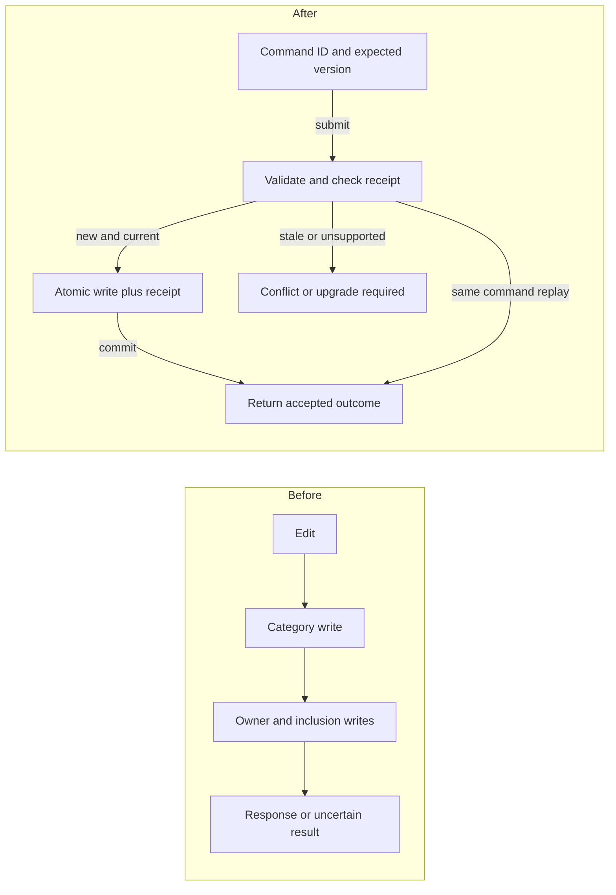

**Change.** Introduce a shared transaction command in the existing financial service. Validate the complete patch before writing; calculate category, inclusion, review, and ownership together in one SQLite transaction. Add Resource Version and a Mutation Receipt keyed by authenticated client and command ID, including a payload digest. Persist the result and receipt with the write. Route desktop, mobile, MCP, AI, imports, and administrative writers through the same version rules; background predictions use conditional application rather than impersonating user commands. Extend protected recurring decisions in F11. Advertise supported write capabilities and return a typed upgrade-required response for clients that cannot submit protected commands; keep compatible reads available.

**Invariant.** One accepted command produces one versioned outcome. A replay with the same payload returns its receipt; a reused ID with different input is rejected; an obsolete version produces a Mutation Conflict without partial writes.

**Validation.** Integration: submit a combined review edit, lose its response, replay it, then submit a competing stale edit. Assert one version increment, one receipt, an unchanged Bank Date, and no partial/conflicting write. Test migration from an existing database and old-client read-only fallback.

**Implementation locations.** [src/services/transactions.ts](../src/services/transactions.ts), [src/services/ownership.ts](../src/services/ownership.ts), [src/mobile/transaction-production-ports.ts](../src/mobile/transaction-production-ports.ts), [src/api/transactions.routes.ts](../src/api/transactions.routes.ts), [src/db/schema.ts](../src/db/schema.ts).

### F02 Give desktop autosave one owner

Dependencies: F01.

**Before.** Save state spans a global promise chain, intended values, queued patches/results, failure records, counters, and a saved timer. Effective Date has additional commit rules.

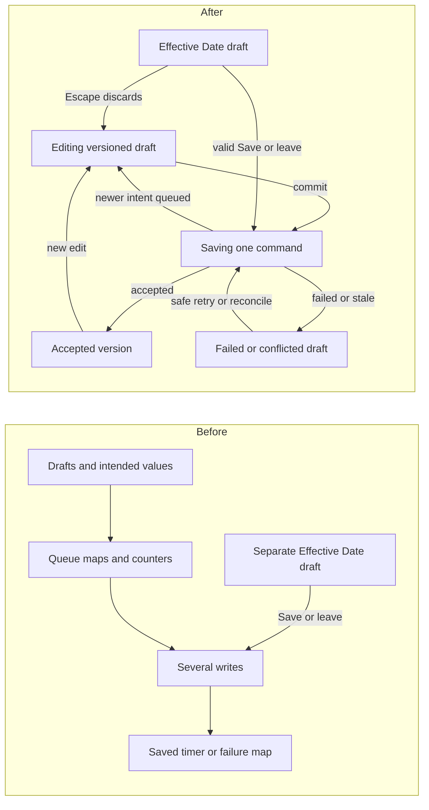

**Change.** Keep a small per-transaction state containing accepted version, draft, pending patch, and one active command. Derive saving/saved/error UI from it. Merge new local intent into the next patch while the active command settles; retry uncertain writes with the same command ID. Preserve failed drafts when changing rows. Keep Effective Date as a separate draft state: incomplete, valid-changed, or unchanged; explicit Save and row departure commit a valid draft, while Escape discards it. Cancel obsolete saved-indicator timers by operation identity.

**Invariant.** An older response never replaces newer intent, one resource has at most one client command in flight, and a conflict preserves the draft for deliberate reconciliation.

**Validation.** Browser flow: type rapidly, change back during a slow save, switch rows, fail/retry, and introduce a competing client edit. Verify final values and date Save/leave/Escape semantics through the server seam.

**Implementation locations.** [dashboard/src/components/ActivityWorkspace.vue](../dashboard/src/components/ActivityWorkspace.vue), [dashboard/src/api/client.ts](../dashboard/src/api/client.ts).

### F03 Make desktop review a single command

Dependencies: F01.

**Before.** Confirm resolves the category, then writes owner/inclusion, then reloads the queue. A later failure can leave the transaction partially resolved.

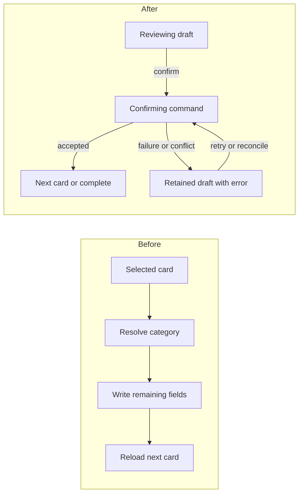

**Change.** Model loading, reviewing, confirming, failed, and complete states with the selected transaction and draft attached only where needed. Submit the entire decision through F01. Advance only on accepted receipt, retain the same card and draft on error/conflict, and fence queue reloads with a generation. Derive the review count from accepted results and refreshed server data.

**Invariant.** Confirm is atomic and a card leaves the review queue only after the Mac accepts the whole decision.

**Validation.** One review E2E: change category, owner, and inclusion; fail the command; retry; confirm the next card and final count. Cover deletion or concurrent review by another client.

**Implementation locations.** [dashboard/src/components/ReviewWorkspace.vue](../dashboard/src/components/ReviewWorkspace.vue).

### F04 Separate iPhone review persistence from card motion

Dependencies: F01, F19.

**Before.** Card identity, local overrides, heldCard, dismissed/later IDs, saving, busy, provider reload, and animation callbacks all participate in queue advancement.

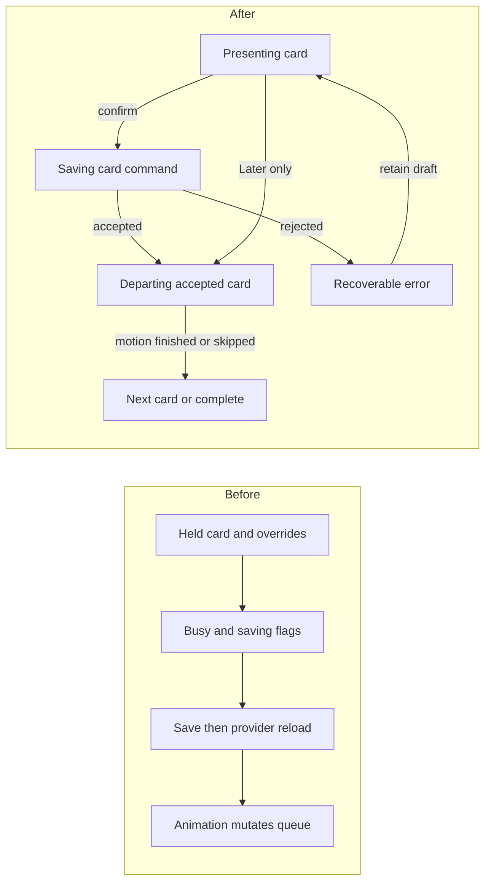

**Change.** Use a local review-session reducer with presenting, saving, departing, advancing, complete, and recoverable-error states. Retain immutable card identity during a command. Make Later a local queue event, distinct from reviewing. Apply the accepted result once, then let the motion completion event reveal the next card; interrupted/reduced motion must also complete that handoff. Do not make a successful write depend on haptics or a successful overview refresh.

**Invariant.** Each accepted review advances once; Later never marks reviewed; failed persistence preserves the card; unmount cannot strand a busy session.

**Validation.** Extend the existing review state tests and one Maestro path covering double-tap, final-card save failure, Later, reduced motion, navigation during departure, and refresh failure after a successful write.

**Implementation locations.** [mobile/app/review.tsx](../mobile/app/review.tsx), [mobile/src/review-state.ts](../mobile/src/review-state.ts), [mobile/src/MoneyData.tsx](../mobile/src/MoneyData.tsx).

### F05 Make iPhone field edits reconcile accepted outcomes

Dependencies: F01, F19.

**Before.** The saving field also represents loading category choices. A successful write can be followed by refresh or haptic failure in the same try block.

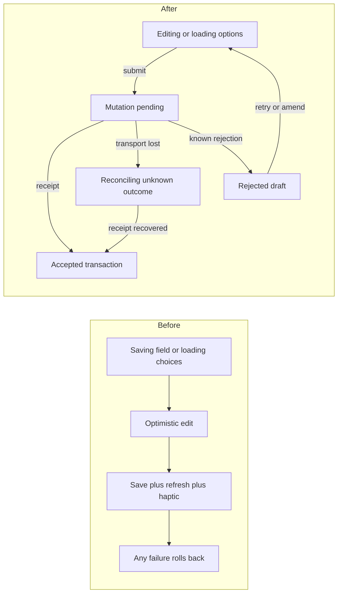

**Change.** Separate option loading from the mutation state. Keep accepted transaction, optimistic draft, active command, and recoverable error together. Commit optimism on a Mutation Receipt; rollback only a known rejected write. Treat unknown outcomes as reconciling and refetch/replay the same command. Run refresh and haptics as independent best-effort effects. Disable mutations in Saved View.

**Invariant.** A secondary effect never turns an accepted financial edit into a displayed rollback.

**Validation.** Test successful save followed by failed haptics/refresh, lost response, conflict, and transaction change during a delayed options request; cover the visible path in the review/detail Maestro flow.

**Implementation locations.** `mobile/app/(tabs)/activity/[id].tsx`, [mobile/src/MoneyData.tsx](../mobile/src/MoneyData.tsx).

### F06 Protect categorization and ownership provenance

Dependencies: F01.

**Before.** Category, confidence, review reason, ignored state, owner target, and owner source are updated in several paths. Async predictions can outlive the input they classified.

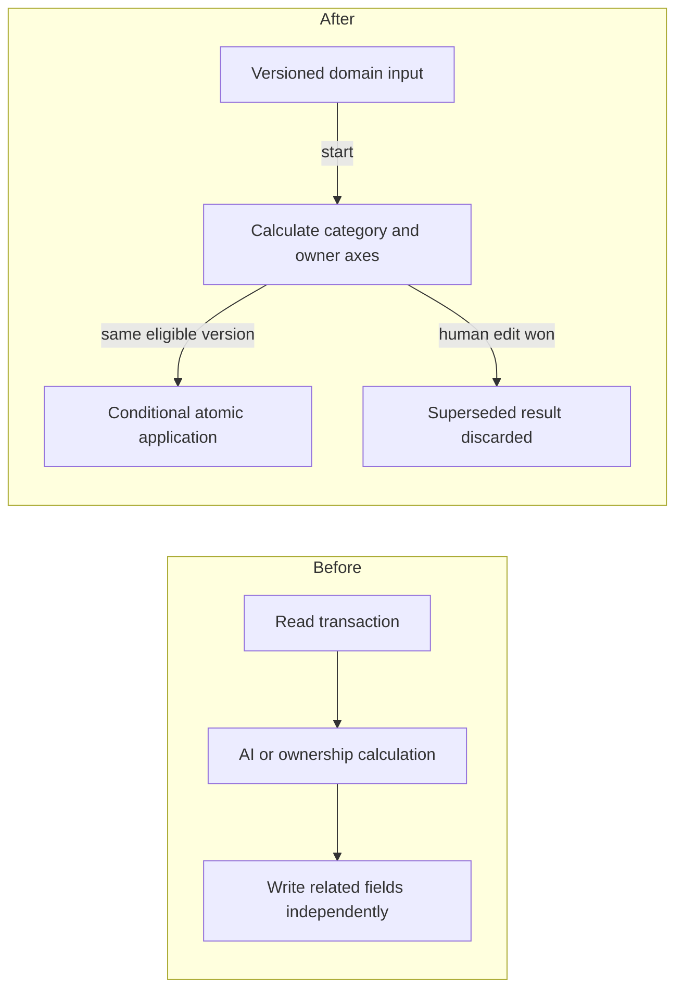

**Change.** Keep category/review and ownership provenance as independent typed domain values with shared normalization functions. Derive review reason and default inclusion in the same command. Capture the input version before classification and conditionally apply only to the same eligible version; drop superseded predictions and recalculate if still needed. Preserve the existing rule/category/account precedence and manual-owner protection. Explicitly record manual inclusion intent if preserving it across later category changes requires provenance; add migration tests for existing rows.

**Invariant.** Review reasons agree with review state, manual ownership survives automatic passes unless force is explicit, and stale AI results cannot overwrite accepted human edits.

**Validation.** Integration with a deferred categorizer: manually edit while classification waits, then resolve it. Assert protected values and unchanged Bank Date; cover explicit forced ownership and inclusion precedence.

**Implementation locations.** [src/ai/categorization/index.ts](../src/ai/categorization/index.ts), [src/services/transactions.ts](../src/services/transactions.ts), [src/services/ownership.ts](../src/services/ownership.ts), [src/db/schema.ts](../src/db/schema.ts).

### F07 Make scrape cancellation drain actual work

Dependencies: None.

**Before.** cancelSession marks cancelled and removes the active entry immediately. scrapeAccount only checks the signal before starting, and the desktop projects job state independently from SSE events.

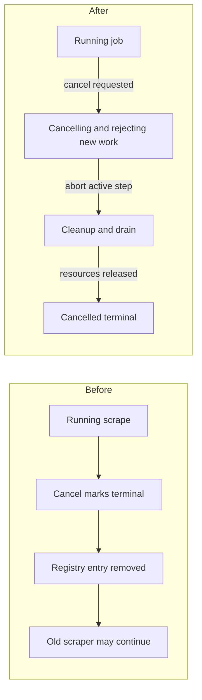

**Change.** Give a scrape job queued, running, cancelling, finalizing, and terminal states. Keep it registered through cleanup and post-processing ownership transfer. Connect cancellation to OTP/manual bridges and the scraper-supported browser teardown path; if teardown cannot interrupt safely, continue displaying cancelling while the active step drains and fence subsequent writes. Admit replacement jobs only after resource release. Emit identity-tagged snapshots with a monotonic event revision; rehydrate desktop state after reconnect and mark orphaned running rows interrupted on startup.

**Invariant.** Cancelled means the job can no longer write or own scraper resources. Cancellation cannot be overwritten by late success/error events.

**Validation.** Extend session-manager integration tests with a deferred scraper: cancel during login, fetching, and persistence; attempt a new job; release the old step; assert no overlapping job or late write. Browser smoke checks cancelling and reconnect hydration.

**Implementation locations.** [src/scraper/session-manager.ts](../src/scraper/session-manager.ts), [src/scraper/scraper.service.ts](../src/scraper/scraper.service.ts), [src/api/scrape.routes.ts](../src/api/scrape.routes.ts), [dashboard/src/components/ScrapingDashboard.vue](../dashboard/src/components/ScrapingDashboard.vue).

### F08 Give bank authentication challenges an identity

Dependencies: F07.

**Before.** OTP/manual requests are keyed by account, while dialogs track account IDs and independent open/submitting booleans. A late response can refer to a replaced challenge.

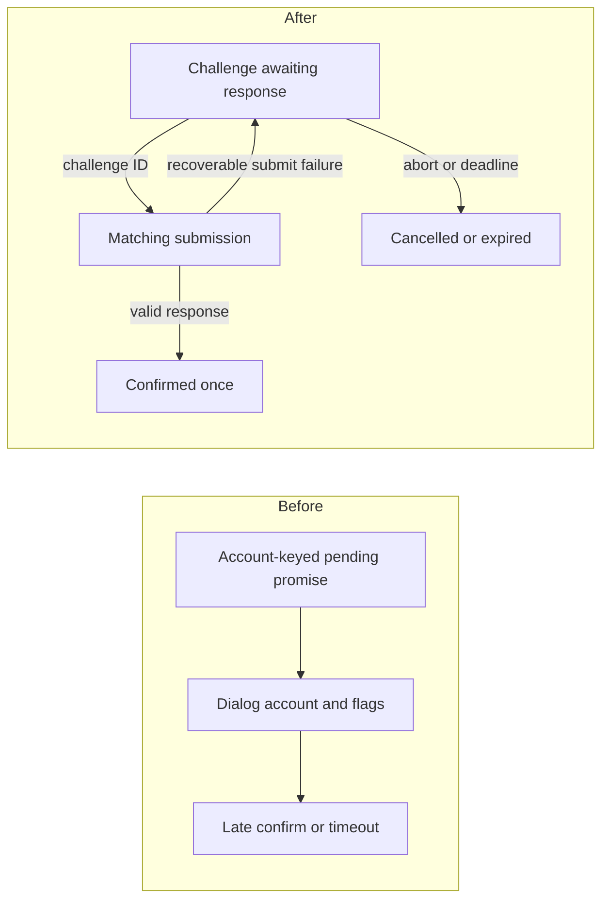

**Change.** Extend the existing bridge with session/challenge ID and AbortSignal, keeping wait, confirm, timeout, cancel, and replace transitions in that module. Confirm only the matching live challenge and settle it once. Represent the desktop challenge as none, awaiting-input, or submitting with matching identity. Close it on session terminal/replacement/reconnect reconciliation; a local dismiss does not falsely complete the server challenge. Use the same rules for OTP and manual confirmation.

**Invariant.** A response to one challenge cannot unlock another; all terminal paths remove the timer and pending resolver.

**Validation.** Focused bridge integration: timeout vs confirmation, replacement vs late submit, cancellation, and repeat confirmation. Reuse the scraping browser path for both OTP and manual login.

**Implementation locations.** [src/scraper/pending-bridge.ts](../src/scraper/pending-bridge.ts), [src/scraper/otp-bridge.ts](../src/scraper/otp-bridge.ts), [src/scraper/manual-action-bridge.ts](../src/scraper/manual-action-bridge.ts), [dashboard/src/composables/useOtpFlow.ts](../dashboard/src/composables/useOtpFlow.ts), [dashboard/src/components/AccountDialogs.vue](../dashboard/src/components/AccountDialogs.vue).

### F09 Track post-import processing to a real outcome

Dependencies: F06, F07.

**Before.** Scrape completion is emitted before background categorization finishes, and import-triggered categorization is detached. Failures are logged without a retryable processing outcome.

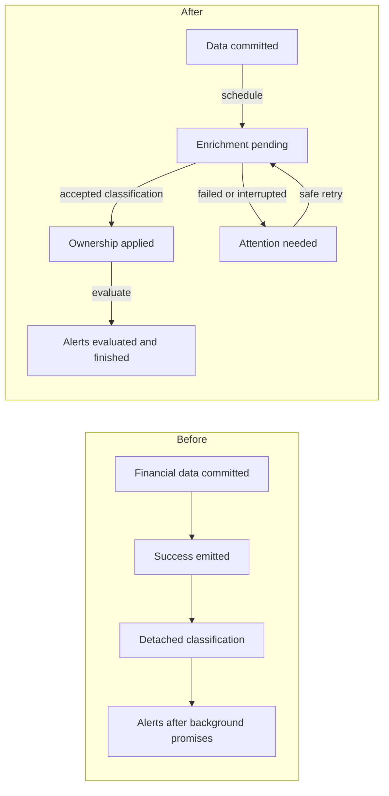

**Change.** Represent acquisition and post-processing separately under the import/job identity: data committed, classification pending, ownership applied, alerts evaluated, finished or attention-needed. Persist enough progress to detect interrupted work and retry classification safely using F06. Keep financial data usable once committed and expose ongoing processing without claiming all work is finished. Shutdown/demo barriers wait for or fence these jobs; do not retry external deliveries blindly.

**Invariant.** A successful import is distinguishable from finished enrichment, and failed enrichment never erases committed transactions.

**Validation.** Import integration with failed categorization and simulated restart: data survives, pending work resumes safely once, and alerts use the final accepted classification state.

**Implementation locations.** [src/scraper/session-manager.ts](../src/scraper/session-manager.ts), [src/scraper/scraper.service.ts](../src/scraper/scraper.service.ts), [src/services/onezero-import.ts](../src/services/onezero-import.ts), [src/telegram/alerts.ts](../src/telegram/alerts.ts).

### F10 Bind statement preview and import to one selection

Dependencies: F01, F09.

**Before.** File, preview, checking, importing, imported, and error can be independently changed. Preview requests can finish after a newer file selection or dialog close.

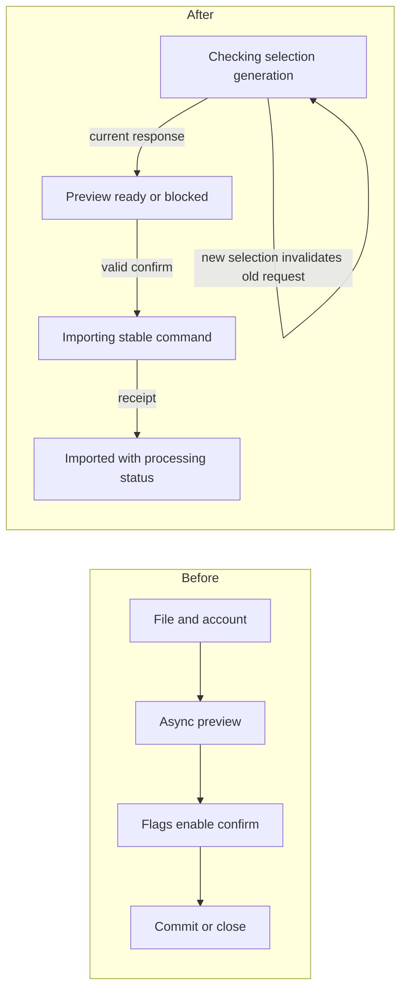

**Change.** Use empty, checking, preview-ready, blocked, importing, imported, and error variants tied to account, selection generation, and file fingerprint. Ignore obsolete previews. Revalidate the current bytes on the Mac at commit as today, use a stable import command ID for uncertain retries, and attach the post-processing job identity. Preserve existing duplicate/ambiguous-row rules and ONE ZERO matching; these are classifications, not new machines.

**Invariant.** Only the selected file/account can be confirmed, an old preview cannot enable import, and replay does not duplicate the import outcome.

**Validation.** Browser/API scenario: select A then B while A is slow, close/reopen, reject ambiguous rows, lose the commit response, and replay; assert B only and deduplicated totals.

**Implementation locations.** [dashboard/src/components/OneZeroImportDialog.vue](../dashboard/src/components/OneZeroImportDialog.vue), [src/services/onezero-import.ts](../src/services/onezero-import.ts), [src/api/onezero-import.routes.ts](../src/api/onezero-import.routes.ts).

### F11 Version recurring-payment decisions

Dependencies: F01.

**Before.** Include/exclude overrides are rows; auto deletes a row. Classification and decisions combine at read time without a versioned decision outcome.

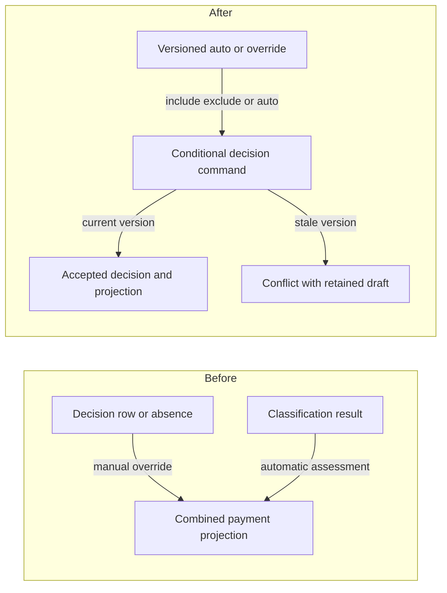

**Change.** Model the decision value as auto, included, or excluded independently of the inferred merchant class. Give the account/currency/merchant decision resource a version that survives returning to auto, and apply commands atomically with receipts. Recompute the projection from current decisions and judgments after acceptance. Keep the server-derived classifications and business grouping unchanged.

**Invariant.** Returning to auto cannot reset conflict protection, and automatic classification never removes a manual decision.

**Validation.** Integration: concurrent include/exclude, lost-response replay, include then auto then stale exclude, and delayed classification after a manual decision.

**Implementation locations.** [src/services/recurring-payments.ts](../src/services/recurring-payments.ts), [src/mobile/recurring-payments-routes.ts](../src/mobile/recurring-payments-routes.ts), [src/api/summary.routes.ts](../src/api/summary.routes.ts), [src/db/schema.ts](../src/db/schema.ts).

### F12 Make recurring classification jobs bounded and identifiable

Dependencies: None.

**Before.** Cache, in-flight batches, a retry timestamp, failed API-key identity, and a response timeout together determine classification state.

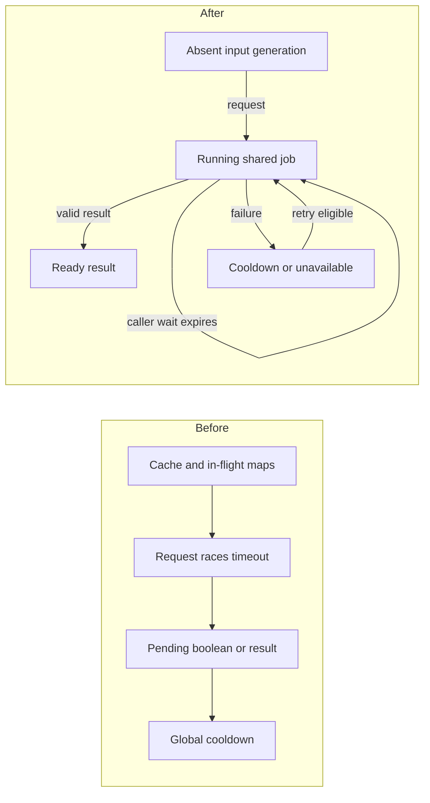

**Change.** Keep an explicit per-input-generation classification job: absent, running, ready, cooldown, or unavailable. Separate the HTTP response wait budget from the lifetime of shared work. Key work by normalized candidate inputs and credential generation; a changed key or dataset fences obsolete results. Bound cache entries, retain retry timing with the matching failure, and expose pending vs unavailable accurately without persisting secrets.

**Invariant.** One matching batch runs once, deadline expiry does not report completed work, and obsolete credential/data generations cannot populate the active cache.

**Validation.** Existing recurring-service integration tests with controlled time: shared calls, response deadline, rate-limit cooldown, API-key replacement, candidate changes, and successful recovery.

**Implementation locations.** [src/services/recurring-payments.ts](../src/services/recurring-payments.ts), [src/ai/typesafe/client.ts](../src/ai/typesafe/client.ts).

### F13 Keep recurring-payment polling alive through recoverable failures

Dependencies: F11, F12.

**Before.** Both clients maintain timers, loading/saving flags, and generations. A polling failure currently stops its chain, and a decision invalidates in-flight results.

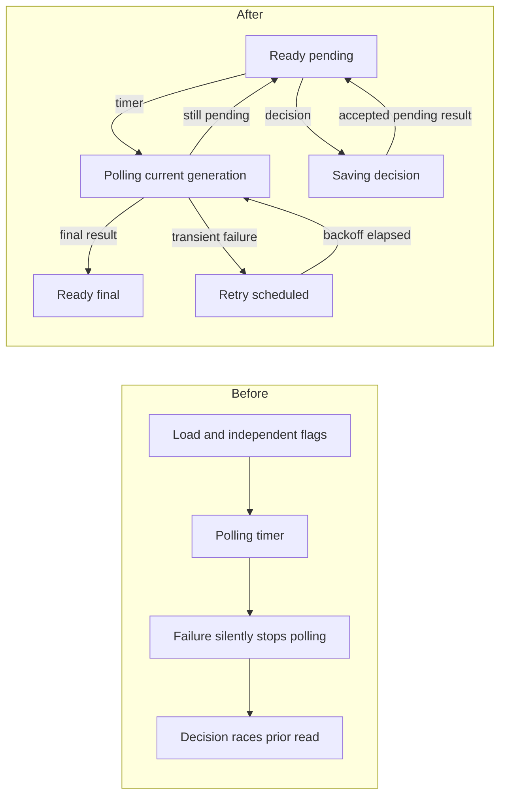

**Change.** Use equivalent local states on each platform: loading, ready-final, ready-pending, polling, saving-decision, and recoverable-error with retained results. Schedule the next poll only after settling the current one, retry transient polling failures with bounded backoff, and fence list/detail requests by identity. A decision suspends polling, installs its accepted projection, then resumes if needed. Cancel on unmount or loss of live access.

**Invariant.** Old polls never overwrite decisions, there is at most one poll per screen, and a recoverable polling failure has a retry path.

**Validation.** One synthetic scenario shared by browser/Maestro: provisional result, poll failure, recovery, manual decision during a delayed poll, detail switch, and unmount.

**Implementation locations.** [dashboard/src/components/RecurringPaymentsPage.vue](../dashboard/src/components/RecurringPaymentsPage.vue), `mobile/app/(tabs)/explore/recurring-payments.tsx`, `mobile/app/(tabs)/explore/recurring-payment-detail.tsx`.

### F14 Unify Advisor reply ownership and durable outcomes

Dependencies: None.

**Before.** A process-local Set protects desktop/mobile replies, each route implements persistence/error rules, and Telegram takes a separate path. Disconnect leaves the client uncertain about the saved exchange.

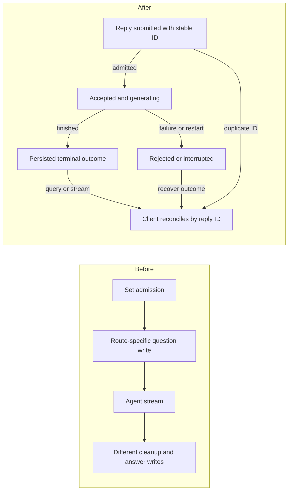

**Change.** Add a shared reply operation with reply ID, session ID, question identity, state, and terminal outcome. Admit at most one reply per session and preserve the global limit across all entrypoints. Persist question acceptance and final outcome so reconnect can query by reply ID; mark interrupted generation on restart and release admission exactly once. Keep server generation running when a view closes or its stream disconnects; explicit cancellation is separate. Use a replay-safe client submission ID to prevent duplicate questions. Keep session files unless their atomic-update requirements justify a narrowly scoped SQLite reply ledger; test the chosen storage transaction boundary.

**Invariant.** A question has one identifiable outcome, every accepted reply releases admission once, and a disconnected client can recover without resending a new question.

**Validation.** Extend both Advisor route suites plus Telegram handler coverage: duplicate submit, desktop/mobile/Telegram collision, persistence failure, dropped stream, deletion during reply, and restart with an accepted but unfinished reply.

**Implementation locations.** [src/ai/sessions.ts](../src/ai/sessions.ts), [src/api/ai.routes.ts](../src/api/ai.routes.ts), [src/mobile/advisor-routes.ts](../src/mobile/advisor-routes.ts), [src/telegram/bot.ts](../src/telegram/bot.ts).

### F15 Settle AI generation and its event bridge once

Dependencies: F14.

**Before.** Turn limits, provider agent_end, and prompt rejection can each push a done sentinel and result/error events. Generator teardown has no single terminal owner.

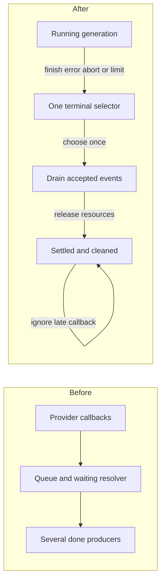

**Change.** Keep a local running/settling/settled generation state with one finish function. Route provider completion, provider error, explicit cancellation, and turn limit through it; ignore late events after terminal selection. Unsubscribe and release the waiting resolver in finally, and propagate application shutdown cancellation. Keep consumer detachment distinct from cancelling the underlying reply operation in F14.

**Invariant.** Exactly one terminal outcome is persisted, no post-terminal deltas are delivered, and generator cleanup cannot leak a waiter or subscription.

**Validation.** Focused async-generator test: turn limit followed by agent_end, provider error followed by prompt rejection, consumer detachment, and application cancellation. Assert one terminal event and released resources.

**Implementation locations.** [src/ai/agent.ts](../src/ai/agent.ts).

### F16 Model desktop Advisor recovery explicitly

Dependencies: F14, F15.

**Before.** Seven flags, message length, active session, and sidebar events determine availability and whether retry means resending or checking history.

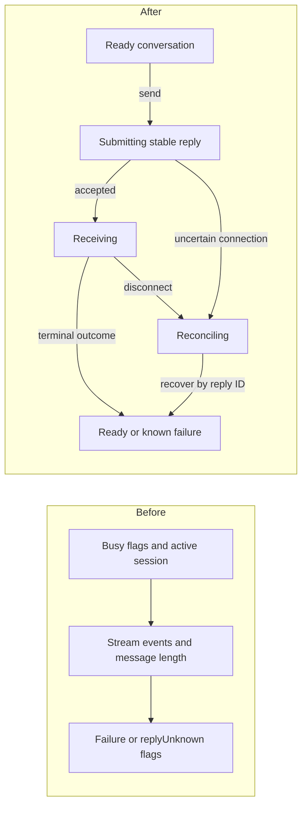

**Change.** Use a local conversation operation state: ready, loading-session, submitting, receiving, reconciling, failed-known, or outcome-unknown. Attach session/reply identity to callbacks. Recover the reply outcome after disconnect; offer a resend only after proving non-acceptance or receiving a replayable terminal result. Keep history creation/deletion as identified operations with shared busy derivation. Preserve the current complete-answer presentation and composer-focus behavior.

**Invariant.** Unknown acceptance cannot create a duplicate question; history switching cannot apply a reply to the wrong conversation.

**Validation.** Browser Advisor path: disconnect before and after server acceptance, reopen history, retry reconciliation, switch sessions during a slow read, and fail session creation/deletion.

**Implementation locations.** [dashboard/src/components/AiChat.vue](../dashboard/src/components/AiChat.vue), [dashboard/src/components/ChatSidebar.vue](../dashboard/src/components/ChatSidebar.vue), [dashboard/src/api/client.ts](../dashboard/src/api/client.ts).

### F17 Give iPhone Advisor the same reply semantics

Dependencies: F14, F15, F19, F20.

**Before.** busy/loading flags, selectionVersion, status text, and a magic streaming timestamp control replies. Failure has no explicit unknown-outcome reconciliation state.

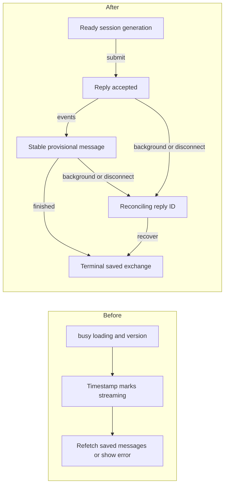

**Change.** Use the same reply contract as desktop, with local opening, submitting, receiving, reconciling, and terminal variants. Give messages stable IDs and explicit provisional status. Fence every session read success/error/finally callback by generation, including new-chat actions. On background/reopen, reconcile an accepted reply instead of posting again. Stop observing and clear private content on terminal authentication invalidation; block sending in Saved View.

**Invariant.** The active conversation owns every displayed event, provisional message IDs remain stable, and mobile retries cannot duplicate an accepted question.

**Validation.** Extend mobile API tests and one Advisor Maestro path for delayed session selection, new chat during loading, partial stream plus disconnect, app background/reopen, and revoked authentication.

**Implementation locations.** `mobile/app/(tabs)/advisor.tsx`, [mobile/src/mobile-api.ts](../mobile/src/mobile-api.ts).

### F18 Scope generated images to their reply

Dependencies: F14.

**Before.** All chats share pendingImages. drainPendingImages removes the entire queue before Telegram delivery completes.

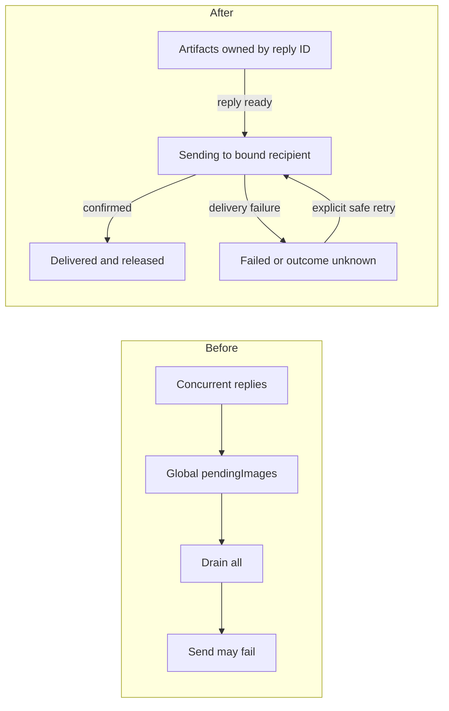

**Change.** Return generated artifacts through the reply operation or a reply-scoped collection. Track each artifact as pending, sending, delivered, failed-known, or outcome-unknown and always bind it to the owning recipient. Release buffers after terminal retention/cleanup. Keep this collection process-local initially; do not promise restart recovery or exactly-once external delivery. Retry a known non-delivery explicitly and preserve ambiguous delivery as unknown.

**Invariant.** One reply cannot drain another reply's images, and attempted delivery is not recorded as confirmed delivery.

**Validation.** Integration with two concurrent replies producing different images and a failing Telegram send; verify recipient isolation, retained known-failed artifact, and bounded buffer cleanup.

**Implementation locations.** [src/ai/image-tools.ts](../src/ai/image-tools.ts), [src/ai/agent.ts](../src/ai/agent.ts), [src/telegram/bot.ts](../src/telegram/bot.ts).

### F19 Model live data and Saved View availability

Dependencies: F20, F31, F36.

**Before.** The provider has four statuses, separately nullable home/credential/error, and in-memory retention after refresh failure. Snapshot metadata is not a persistent Saved View lifecycle.

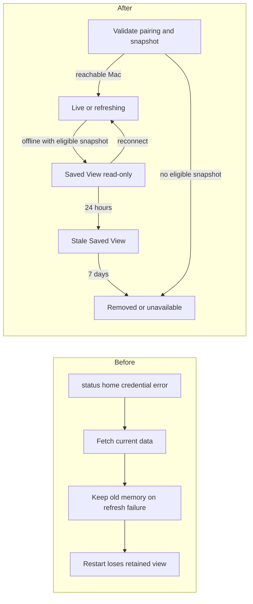

**Change.** Use booting, unpaired, connecting, live, refreshing-live, saved-view, stale-saved-view, and unavailable states with snapshot identity and provenance attached. Keep snapshot freshness, transport, completeness, and authentication as separate typed axes where they legitimately coexist. D1 gates adding persistent storage. For that branch, validate and encrypt a per-pairing snapshot in app-private storage with a Keychain-held key; do not put large snapshots in SecureStore. Cache only accepted complete/cacheable data and explicitly bounded detail resources; never fabricate uncached screens. Partial snapshots remain usable live and cannot replace the last complete Saved View. Honor the approved stale-after-24-hours/delete-after-7-days policy through explicit server staleAt/deleteAfter metadata; retain the current five-minute maxAgeSeconds as live-refresh guidance rather than silently changing its contract. Saved View is read-only, including review, recurring decisions, and Advisor submissions. If D1 is deferred, implement the live/refresh/error correctness states now and leave the persistent variants out.

**Invariant.** Every displayed value has a known snapshot/pairing identity; a reconnect does not silently replace a newer snapshot with an older response; Saved View never enables mutations.

**Validation.** Mobile integration and Maestro: initial launch without cache, connection loss/restart with cache, partial live response, wrong server, corrupted payload, time changes, 24-hour stale boundary, seven-day removal, and read-only coverage on every mutation entrypoint.

**Implementation locations.** [mobile/src/MoneyData.tsx](../mobile/src/MoneyData.tsx), [mobile/src/mobile-api.ts](../mobile/src/mobile-api.ts), [mobile/src/ConnectionState.tsx](../mobile/src/ConnectionState.tsx), [src/mobile/bootstrap-contract.ts](../src/mobile/bootstrap-contract.ts), [src/mobile/bootstrap-adapter.ts](../src/mobile/bootstrap-adapter.ts).

### F20 Invalidate revoked or expired client access coherently

Dependencies: None.

**Before.** The registry already enforces revocation/expiration/rotation, but mobile maps authentication_revoked into display text without a provider-wide terminal invalidation transition.

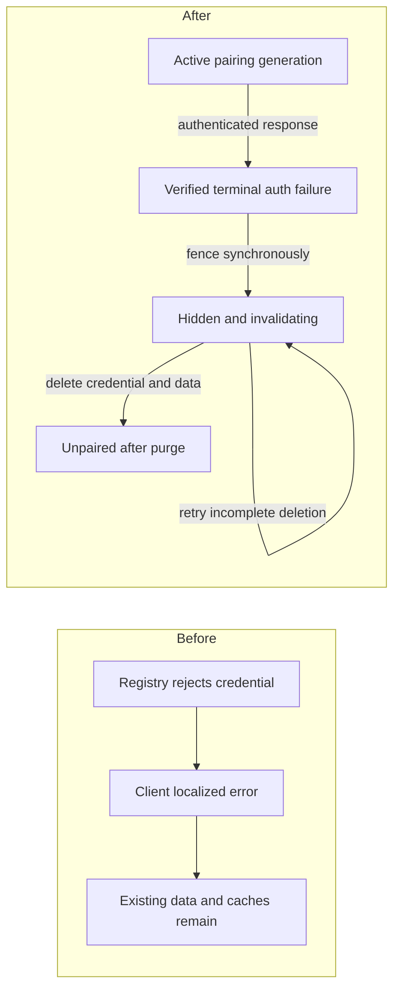

**Change.** Preserve the existing registry authority and digest/version design. Return typed API failures before localization. Distinguish terminal credential invalidation from network/timeout/capability failures. On verified revoked, expired, or invalid credentials, synchronously hide private data, fence/abort in-flight work, invalidate all caches/observers, and delete pairing credentials and Saved View. Keep a non-displayable invalidation marker until deletion completes, including after restart; failures cannot restore display rights. Re-pairing creates a new credential generation. A wrong-server response fails identity validation and cannot impersonate a revocation event.

**Invariant.** Late responses from an invalidated pairing cannot repopulate memory or storage. Offline revocation cannot be observed until reconnect; retention limits remain the offline bound.

**Validation.** Integration: revoke while reads/reply/mutation are pending, return a late success, fail storage deletion, restart, and re-pair. Assert immediate hiding and no resurrection; preserve device registry rotation/revocation tests.

**Implementation locations.** [src/mobile/device-registry.ts](../src/mobile/device-registry.ts), [src/mobile/mobile-auth.ts](../src/mobile/mobile-auth.ts), [mobile/src/mobile-api.ts](../mobile/src/mobile-api.ts), [mobile/src/MoneyData.tsx](../mobile/src/MoneyData.tsx), [mobile/src/security/pairing-credential-store.ts](../mobile/src/security/pairing-credential-store.ts).

### F21 Unify Mobile Access lifecycle ownership

Dependencies: None.

**Before.** Public transport status is supplemented by startAttempted, resumeEligible, enabled, recoveryActive, server presence, remembered disable results, and queued operations.

```mermaid
flowchart LR
  subgraph before["Before"]
    direction TB
    B0["Desired enabled flag"]
    B1["Runtime status and server flags"]
    B2["Recovery timer and pairing manager"]
    B0 --> B1
    B1 --> B2
  end
  subgraph after["After"]
    direction TB
    A0["Disabled or stopped"]
    A1["Starting desired generation"]
    A2["Running or recoverable"]
    A3["Disabling or stopping"]
    A0 -->|"enable"| A1
    A1 -->|"reconcile"| A2
    A2 -->|"one recovery check"| A2
    A2 -->|"disable or quit"| A3
    A3 -->|"resources released"| A0
  end
```

**Change.** Keep the existing runtime/control seam and serialized commands. Replace dependent flag combinations with explicit resource-bearing runtime variants and a separate persisted desired-enabled value. Treat enable, disable, shutdown, and recovery as identified operations. One recovery timer belongs to the current enabled generation, is armed after completion, and is cancelled/fenced on disable/shutdown. Derive pairing-manager availability from the accepted running route identity. Preserve the distinction between process shutdown and explicit route removal.

**Invariant.** Persisted opt-in, loopback-server ownership, recovery eligibility, and pairing availability cannot contradict the accepted lifecycle state.

**Validation.** Extend existing runtime/control suites for enable-disable-enable interleavings, failure while closing, timer fires during shutdown, route identity changes, repeated wake, and recovery after startup failure.

**Implementation locations.** [electron/mobile-access/mobile-access-runtime.ts](../electron/mobile-access/mobile-access-runtime.ts), [electron/mobile-access/mobile-access-control.ts](../electron/mobile-access/mobile-access-control.ts).

### F22 Make durable route ownership transitions explicit

Dependencies: None.

**Before.** lastKnownTarget and pendingTarget encode a durable prepare/mutate/verify protocol. The coordinator already serializes work and refuses unowned route mutation.

```mermaid
flowchart LR
  subgraph before["Before"]
    direction TB
    B0["Nullable known and pending targets"]
    B1["CLI mutation"]
    B2["Inspect and rewrite proof"]
    B0 --> B1
    B1 --> B2
  end
  subgraph after["After"]
    direction TB
    A0["Absent or verified proof"]
    A1["Prepared intent persisted"]
    A2["CLI attempted"]
    A3["Verified proof or verified absence"]
    A4["Conflict retained"]
    A0 -->|"owned change"| A1
    A1 -->|"apply"| A2
    A2 -->|"inspect actual route"| A3
    A2 -->|"foreign target"| A4
    A1 -->|"resume inspection"| A3
  end
```

**Change.** Preserve that protocol and its conflict policy. Express absent, prepared, and verified ownership as typed records or normalized variants with a schema migration if the stored shape changes. Keep intent persistence before CLI mutation and verification before committing ownership. Model disable as removal-requested then verified-absent before clearing the record; uncertain CLI outcomes re-inspect rather than assume success. Do not create a second route controller.

**Invariant.** Only a route with durable ownership proof is changed, and every interrupted write is recoverable by inspection.

**Validation.** Extend current coordinator tests with crash points before CLI, after CLI but before verification, after removal but before clearing ownership, malformed records, and foreign route replacement.

**Implementation locations.** [electron/mobile-access/tailscale-serve-coordinator.ts](../electron/mobile-access/tailscale-serve-coordinator.ts), [electron/mobile-access/serve-ownership-store.ts](../electron/mobile-access/serve-ownership-store.ts).

### F23 Align pairing screens with the existing pairing machine

Dependencies: F20, F21, F22.

**Before.** The server is already an explicit pairing machine. Desktop QR state and scanner permission/progress/results add separate flags and abort lifetimes around it.

```mermaid
flowchart LR
  subgraph before["Before"]
    direction TB
    B0["Explicit server pairing"]
    B1["Desktop QR flags"]
    B2["Scanner kind plus permission and controller"]
    B0 -->|"status projection"| B1
    B0 -->|"poll and exchange"| B2
  end
  subgraph after["After"]
    direction TB
    A0["Current pairing identity"]
    A1["Awaiting approval"]
    A2["Exchanging and storing"]
    A3["Connected generation"]
    A4["Cancelled or expired"]
    A0 -->|"request accepted"| A1
    A1 -->|"approved"| A2
    A2 -->|"credential stored"| A3
    A0 -->|"dismiss"| A4
    A1 -->|"reject or expire"| A4
    A2 -->|"cancel before commit"| A4
  end
```

**Change.** Retain the server manager and its one-time claimant/credential semantics. Model desktop QR generation, visible code, approval, and expiration with request identity. Represent scanner camera permission separately from scanning/checking/requesting/awaiting-approval/exchanging/storing/connected/error. Extend cancellation to the health check and every pairing stage, and fence completion after dismissal. Treat an issued but not-yet-stored credential as a recoverable exchange/storage step within server expiry; clear the old pairing generation before displaying data from a new server.

**Invariant.** Closing or replacing a scan cannot persist a late credential, a stale QR result cannot revive after disable, and retry respects the server's existing claimant binding.

**Validation.** Existing pairing tests plus synthetic scan/desktop path: disable during QR generation, reject/expire approval, cancel health check, lose exchange response, fail Keychain write, and dismiss during storage.

**Implementation locations.** [src/mobile/pairing-session.ts](../src/mobile/pairing-session.ts), [dashboard/src/components/MobileAccessSettings.vue](../dashboard/src/components/MobileAccessSettings.vue), [mobile/app/scanner.tsx](../mobile/app/scanner.tsx), [mobile/src/mobile-api.ts](../mobile/src/mobile-api.ts).

### F24 Fence OAuth completion and credential refresh races

Dependencies: None.

**Before.** Login ownership lives in nullable resolve/reject/promise/controller fields, while polling and manual completion can both finish the UI. Refresh can overlap login/logout.

```mermaid
flowchart LR
  subgraph before["Before"]
    direction TB
    B0["Nullable login handles"]
    B1["Polling and pasted code"]
    B2["Unfenced credential refresh or logout"]
    B0 --> B1
    B1 --> B2
  end
  subgraph after["After"]
    direction TB
    A0["Idle provider generation"]
    A1["Current login or shared refresh"]
    A2["Commit matching generation"]
    A3["Cancelled or superseded"]
    A0 -->|"start"| A1
    A1 -->|"success"| A2
    A1 -->|"cancel logout or replace"| A3
    A3 -->|"cleanup"| A0
    A3 -->|"ignore late completion"| A3
  end
```

**Change.** Keep the existing OAuthFlow interface. Use one attempt object with ID, controller, promise, and state, plus a provider credential generation. Finish/cancel a specific attempt once and ignore its late callbacks. Poll only the current attempt and stop on disposal. Share one refresh promise per provider/generation; commit refreshed credentials only if that generation is still current. Serialize credential persistence with logout/replacement so a late refresh cannot restore removed credentials. Preserve successful localhost-callback/manual-code races and current fallback order.

**Invariant.** Cancel/logout cannot be undone by an older attempt, and concurrent callers share the same current-generation refresh.

**Validation.** Extend auth tests: cancel then restart before old finally, callback vs pasted code, concurrent refresh, logout during refresh, disk write failure, and component unmount during polling.

**Implementation locations.** [src/ai/auth.ts](../src/ai/auth.ts), [dashboard/src/composables/useOAuth.ts](../dashboard/src/composables/useOAuth.ts), [src/api/settings.routes.ts](../src/api/settings.routes.ts).

### F25 Coordinate desktop startup shutdown and wake

Dependencies: F07, F09.

**Before.** Window visibility, isQuitting, a second quitting flag, application callbacks, and background service shutdown compose the app lifecycle without one coordinator.

```mermaid
flowchart LR
  subgraph before["Before"]
    direction TB
    B0["Electron callbacks"]
    B1["Two quit flags"]
    B2["Independent async cleanup"]
    B3["Exit"]
    B0 --> B1
    B1 --> B2
    B2 --> B3
  end
  subgraph after["After"]
    direction TB
    A0["Starting"]
    A1["Running with visible or hidden window"]
    A2["Recovering"]
    A3["Stopping and draining"]
    A4["Stopped or interrupted exit"]
    A0 -->|"ready"| A1
    A1 -->|"wake"| A2
    A2 -->|"recovered"| A1
    A1 -->|"quit"| A3
    A2 -->|"quit wins"| A3
    A3 -->|"cleanup or deadline"| A4
  end
```

**Change.** Use a process-local lifecycle coordinator with starting, running, recovering, stopping, and stopped/failed states. Window visible/hidden remains a separate simple value; hiding to tray keeps services running. Coalesce wake notifications, reject new work once stopping begins, request cancellation, and await owned cleanup. Use a bounded shutdown deadline; on forced exit leave durable interrupted job/reply records for startup recovery. Preserve startup ordering for secure storage, configuration, database, servers, and trusted renderer setup.

**Invariant.** Shutdown starts once, no wake can restart services after stop begins, and the app never records unfinished work as successful merely to exit.

**Validation.** Integration with fake lifecycle ports: repeated wake, quit during recovery, partial startup failure, hanging scraper, close-to-tray, and second quit. Validate installed updater shutdown integration separately in F27.

**Implementation locations.** [electron/main.ts](../electron/main.ts), [src/server.ts](../src/server.ts), [src/index.ts](../src/index.ts).

### F26 Give scheduled work and Telegram polling a wake owner

Dependencies: F07, F25.

**Before.** Scheduler task handles and lastCronFireTime determine catch-up, while Telegram restarts through an awaited stop/start pair. Several wake callbacks can still request recovery.

```mermaid
flowchart LR
  subgraph before["Before"]
    direction TB
    B0["Cron handles and time checkpoint"]
    B1["Wake invokes catch-up and restart"]
    B2["Independent scheduled work and bot polling"]
    B0 --> B1
    B1 --> B2
  end
  subgraph after["After"]
    direction TB
    A0["Running background generation"]
    A1["One wake recovery"]
    A2["Admit due occurrence once"]
    A3["Restart bot after stop"]
    A4["Running recovered generation"]
    A0 -->|"wake"| A1
    A1 -->|"scheduler check"| A2
    A1 -->|"bot recovery"| A3
    A2 -->|"admitted or recorded skip"| A4
    A3 -->|"old poller stopped"| A4
  end
```

**Change.** Let F25 own a single recovery promise and generation. Scheduler start/stop remains idempotent; model a due occurrence as pending, admitted, skipped-busy, or completed and persist the last admitted occurrence if restart catch-up is required. Check demo/desired-enabled state before catch-up. Represent Telegram as stopped, starting, polling, or stopping and do not start a new poller until the previous stop settles. Keep typing indicators scoped to their reply with finally cleanup.

**Invariant.** Repeated wake does not duplicate a scheduled job or Telegram poller, and recording a schedule check does not falsely record successful work.

**Validation.** Controlled-clock integration: missed occurrence during sleep, busy job at wake, repeated wake, demo mode, stop failure, and Telegram stop/start ordering. Reuse existing scrape admission coverage.

**Implementation locations.** [src/scraper/scheduler.ts](../src/scraper/scheduler.ts), [src/telegram/bot.ts](../src/telegram/bot.ts), [src/server.ts](../src/server.ts).

### F27 Type and reconcile application update status

Dependencies: F25.

**Before.** Updater events send free-form status strings; the settings screen also sets local checking/error state and stores version/progress separately.

```mermaid
flowchart LR
  subgraph before["Before"]
    direction TB
    B0["Updater events"]
    B1["Status string plus version and percent"]
    B2["Renderer-local checking and install action"]
    B0 --> B1
    B1 --> B2
  end
  subgraph after["After"]
    direction TB
    A0["Authoritative update snapshot"]
    A1["Checking"]
    A2["Downloading"]
    A3["Ready to install"]
    A4["Stopping for install"]
    A0 -->|"check"| A1
    A1 -->|"available"| A2
    A2 -->|"verified download"| A3
    A3 -->|"install"| A4
    A3 -->|"Later"| A3
  end
```

**Change.** Define a discriminated update snapshot at the Electron IPC seam, owned by main and queryable when settings opens. Include operation identity and retain downloaded-update readiness across remounts. Derive checking, progress, and install eligibility from the snapshot; serialize/coalesce checks, preserve desired automatic-check preference, and route installation through F25 cleanup. Keep progress as numeric data within downloading, not a new state for every percentage.

**Invariant.** The renderer cannot display an install action without a downloaded update, and remounting does not lose the authoritative updater state.

**Validation.** Synthetic Electron/browser flow: open settings after download, repeated manual checks, disable periodic checks, error then recovery, Later then install. Run the documented signed-update check before distributing a changed installed-update path.

**Implementation locations.** [electron/main.ts](../electron/main.ts), [electron/preload.cts](../electron/preload.cts), [dashboard/src/components/SettingsPage.vue](../dashboard/src/components/SettingsPage.vue).

### F28 Separate alert analysis from delivery bookkeeping

Dependencies: F09, F14.

**Before.** Internal baselines advance after analysis even if sending failed. Conversation context is appended before delivery, while per-chat send errors are swallowed.

```mermaid
flowchart LR
  subgraph before["Before"]
    direction TB
    B0["Analyze against previous baseline"]
    B1["Append conversation then send"]
    B2["Errors logged"]
    B3["Baseline always advanced"]
    B0 --> B1
    B1 --> B2
    B2 --> B3
  end
  subgraph after["After"]
    direction TB
    A0["Evaluation identity"]
    A1["Silent or material decision"]
    A2["Per-recipient delivery outcome"]
    A3["Context and retryable delivery record"]
    A0 -->|"evaluate once"| A1
    A1 -->|"silent baseline committed"| A3
    A1 -->|"material alert"| A2
    A2 -->|"record actual outcome"| A3
  end
```

**Change.** Keep analysis progress and delivery outcome as separate records. Key an alert evaluation by committed job or monthly period. A silent evaluation can advance its analysis baseline deliberately; a material alert records per-recipient pending/sent/failed/unknown delivery and only appends confirmed-delivery conversation context at the appropriate point. For chunked messages retain per-chunk outcomes. Preserve failed alerts for explicit retry without re-running analysis, and coalesce duplicate evaluation triggers. Do not promise exactly-once Telegram delivery when a response is lost.

**Invariant.** A failed recipient is not marked notified, duplicate evaluation does not create a second logical alert, and baseline advancement cannot erase a pending material alert.

**Validation.** Integration: silent result, one of two recipients fails, failure after a delivered chunk, lost send response, repeated scrape event, and monthly trigger replay. Assert analysis and notification history separately.

**Implementation locations.** [src/telegram/alerts.ts](../src/telegram/alerts.ts), [src/telegram/alert-settings.ts](../src/telegram/alert-settings.ts), [src/telegram/bot.ts](../src/telegram/bot.ts).

### F29 Switch demo data only after work is quiescent

Dependencies: F07, F09, F25.

**Before.** Demo mode swaps mutable database exports, seeds data, and changes scheduler state while other jobs may already hold work in flight.

```mermaid
flowchart LR
  subgraph before["Before"]
    direction TB
    B0["Real exports"]
    B1["Swap bindings"]
    B2["Seed and stop scheduler"]
    B3["Old jobs may still finish"]
    B0 --> B1
    B1 --> B2
    B2 --> B3
  end
  subgraph after["After"]
    direction TB
    A0["Current mode"]
    A1["Pause admission and drain"]
    A2["Prepare candidate database"]
    A3["Commit mode generation"]
    A4["Resume allowed services"]
    A0 -->|"toggle"| A1
    A1 -->|"quiescent"| A2
    A2 -->|"validated"| A3
    A3 -->|"invalidate old readers"| A4
    A2 -->|"preparation failed"| A0
  end
```

**Change.** Make real, switching-to-demo, demo, and switching-to-real states owned by a mode transition operation. Pause job admission and cancel/drain or fence active financial work before switching. Build, migrate, and seed a candidate demo database before committing the bindings. Bind long-running work to the database generation it started with. After the switch invalidate caches/client generations and restore the intended scheduler only for real mode. Roll back a failed preparation without changing the active mode.

**Invariant.** A job started against real data cannot finish against demo bindings or vice versa, and a failed demo seed cannot leave a half-switched app.

**Validation.** Integration: toggle during scrape, classification, Advisor tool execution, and failing demo seed; toggle back and verify database isolation, schedule behavior, and invalidated caches.

**Implementation locations.** [src/db/connection.ts](../src/db/connection.ts), [src/api/demo.routes.ts](../src/api/demo.routes.ts), [src/server.ts](../src/server.ts), [dashboard/src/components/SettingsPage.vue](../dashboard/src/components/SettingsPage.vue).

### F30 Represent exchange-rate freshness and retry eligibility together

Dependencies: None.

**Before.** Cached values, lastFetched, lastFailedAt, and inflightFetch jointly decide fresh/stale/fallback behavior. The no-cache failure path does not use the stale-cache cooldown guard.

```mermaid
flowchart LR
  subgraph before["Before"]
    direction TB
    B0["Values and fetched timestamp"]
    B1["Separate failure timestamp"]
    B2["Optional in-flight promise"]
    B3["Fresh stale or ILS fallback"]
    B0 --> B1
    B1 --> B2
    B2 --> B3
  end
  subgraph after["After"]
    direction TB
    A0["Absent or expired"]
    A1["Shared fetching"]
    A2["Fresh rates"]
    A3["Cooldown with stale or unavailable data"]
    A0 -->|"eligible request"| A1
    A1 -->|"validated success"| A2
    A1 -->|"failure"| A3
    A3 -->|"retry time reached"| A1
    A2 -->|"TTL elapsed"| A0
  end
```

**Change.** Keep a small explicit cache record with absent, fetching, fresh, stale-cooldown, and unavailable-cooldown states. Share one fetch, carry the accepted fetchedAt with values, and apply retry eligibility after every failure including first-load failure. Preserve an ILS-only fallback as explicitly unavailable foreign rates rather than a successful rate snapshot. Keep existing TTL and calculation semantics unless a separate product change requests them.

**Invariant.** A fallback never looks fresh, callers cannot bypass cooldown when no rates exist, and concurrent reads share one attempt.

**Validation.** Controlled-clock service test for first failure without cache, stale-cache failure, shared fetch, TTL boundary, cooldown expiry, and partial upstream failure without fabricated rates.

**Implementation locations.** [src/services/exchange-rates.ts](../src/services/exchange-rates.ts).

### F31 Fence request caches by data and credential generation

Dependencies: None.

**Before.** History, review-options, and overview caches store pending/resolved promises. Resetting maps does not by itself stop old promises or failure handlers from affecting newer entries.

```mermaid
flowchart LR
  subgraph before["Before"]
    direction TB
    B0["Map key to promise"]
    B1["Map cleared or replaced"]
    B2["Old promise settles"]
    B0 --> B1
    B1 --> B2
  end
  subgraph after["After"]
    direction TB
    A0["Absent scoped key"]
    A1["Pending entry identity"]
    A2["Resolved value"]
    A3["Retired generation"]
    A0 -->|"load"| A1
    A1 -->|"same entry and scope"| A2
    A1 -->|"matching rejection"| A0
    A1 -->|"invalidate"| A3
    A2 -->|"invalidate"| A3
    A3 -->|"ignore late settle"| A3
  end
```

**Change.** Keep the existing promise cache approach. Give each entry and cache scope an identity tied to pairing/data generation and query key. Allow absent, pending, and resolved entries; remove a failed entry only if it is still the same entry. Invalidation retires the generation and optionally aborts unshared work, while consumers ignore retired completions. Bound long-lived month/count entries. Apply the same rule to prefetch and screen use; treat an empty result as a valid resolved value.

**Invariant.** Old cache work cannot delete or populate a replacement entry, and data cannot cross pairing/demo generations.

**Validation.** Extend history-cache tests for reject-after-replacement, resolve-after-invalidation, shared prefetch, empty data, credential change, and bounded eviction. Test through the public load/peek/invalidate interface.

**Implementation locations.** [mobile/src/history-cache.ts](../mobile/src/history-cache.ts), [mobile/src/MoneyData.tsx](../mobile/src/MoneyData.tsx).

### F32 Own stream connection and parsing teardown

Dependencies: None.

**Before.** Desktop marks connected before fetch succeeds and schedules reconnection through callbacks. Stream parsers keep separate buffer/event state and disposal rules.

```mermaid
flowchart LR
  subgraph before["Before"]
    direction TB
    B0["Create stream and mark connected"]
    B1["Buffer fragments"]
    B2["Error schedules reconnect"]
    B3["Close independently"]
    B0 --> B1
    B1 --> B2
    B2 --> B3
  end
  subgraph after["After"]
    direction TB
    A0["Connecting generation"]
    A1["Open verified stream"]
    A2["Reconnect wait"]
    A3["Disposed"]
    A0 -->|"validated headers"| A1
    A0 -->|"connection failed"| A2
    A1 -->|"unexpected EOF or error"| A2
    A2 -->|"one retry timer"| A0
    A0 -->|"dispose"| A3
    A1 -->|"dispose"| A3
    A2 -->|"dispose"| A3
  end
```

**Change.** Represent disconnected, connecting, open, reconnect-wait, and disposed states with connection generation. Mark open only after response/identity validation. Each stream owns one abort controller, one bounded buffer, and its retry timer; errors from retired connections cannot reconnect. Use named parsing state for incomplete frames and event/data accumulation, accepting valid SSE line endings and fragmented chunks. Keep generic parsing separate from reply/job domain completion: EOF alone is not proof of an accepted terminal result. Rehydrate authoritative job state after reconnect.

**Invariant.** Disposed streams never reconnect, one active connection exists per owner, and chunk boundaries do not change the events observed by clients.

**Validation.** Streaming integration with delayed headers, split event/data/UTF-8 chunks, CRLF, malformed/oversize frames, EOF, abort while retry timer is armed, and stale connection errors after replacement.

**Implementation locations.** [dashboard/src/composables/useSseConnection.ts](../dashboard/src/composables/useSseConnection.ts), [dashboard/src/api/scrape-stream.ts](../dashboard/src/api/scrape-stream.ts), [dashboard/src/api/client.ts](../dashboard/src/api/client.ts), [mobile/src/mobile-api.ts](../mobile/src/mobile-api.ts).

### F33 Keep request outcomes cancellation and retries distinct

Dependencies: None.

**Before.** Timeout and external cancellation share abort machinery; retry loops are separate from callers and semantic API errors are localized early.

```mermaid
flowchart LR
  subgraph before["Before"]
    direction TB
    B0["Fetch plus timeout"]
    B1["Abort signal and catch"]
    B2["Localized error or retry loop"]
    B0 --> B1
    B1 --> B2
  end
  subgraph after["After"]
    direction TB
    A0["Attempt with deadline"]
    A1["Typed accepted outcome"]
    A2["Typed known failure"]
    A3["Cancelled or network unknown"]
    A4["Bounded backoff"]
    A0 -->|"success"| A1
    A0 -->|"API rejection"| A2
    A0 -->|"abort or transport loss"| A3
    A2 -->|"eligible retryable response"| A4
    A4 -->|"current attempt budget"| A0
    A4 -->|"cancel"| A3
  end
```

**Change.** Use a typed request outcome at the HTTP seam: success, API failure, timeout, cancelled, or network-unknown. Preserve safe server error codes until the UI translates them. Link caller cancellation to each attempt and backoff, remove listeners in finally, and settle once. Keep TypeSafe's existing bounded retry policy for its known retryable responses, validate and clamp Retry-After, and stop backoff on cancellation. Financial commands retry only via their stable command ID; other side-effecting requests are not blindly replayed.

**Invariant.** User cancellation cannot look like a server failure, and an uncertain financial outcome is reconciled through its receipt.

**Validation.** API seam tests for simultaneous timeout/abort, error-body parse failure, negative/large Retry-After, cancellation in backoff, exhausted retries, and response loss after a financial commit.

**Implementation locations.** [mobile/src/mobile-api.ts](../mobile/src/mobile-api.ts), [mobile/src/pairing/check-mobile-health.ts](../mobile/src/pairing/check-mobile-health.ts), [src/ai/typesafe/client.ts](../src/ai/typesafe/client.ts).

### F34 Preserve one terminal child-process outcome

Dependencies: None.

**Before.** The adapter already guards completion with a boolean and terminates process trees on timeout/output overflow. Error/close/timeout remain competing terminal callbacks.

```mermaid
flowchart LR
  subgraph before["Before"]
    direction TB
    B0["Running child"]
    B1["completed boolean"]
    B2["Error close timeout or overflow callbacks"]
    B0 --> B1
    B1 --> B2
  end
  subgraph after["After"]
    direction TB
    A0["Running child"]
    A1["Terminal outcome selected once"]
    A2["Termination and resource cleanup"]
    A3["Settled result"]
    A0 -->|"exit error timeout or abort"| A1
    A1 -->|"cleanup"| A2
    A2 -->|"resources released"| A3
    A3 -->|"ignore late callbacks"| A3
  end
```

**Change.** Keep the current small implementation and process-group behavior. Centralize settlement and cleanup in one function carrying a tagged outcome; add caller cancellation only where a lifecycle owner needs it. Clean listeners/timer after terminal selection while still consuming or safely closing pipes. Keep byte bounds and distinguish a termination request from observed process exit when shutdown must await resource release. Do not introduce a generic process framework.

**Invariant.** Exactly one result is returned and a lifecycle owner can distinguish timed-out work from a process tree confirmed released.

**Validation.** Extend the existing adapter tests with close-after-timeout, error-after-close, cancellation, output overflow, failed group signal fallback, and cleanup verification.

**Implementation locations.** [electron/mobile-access/exec-file-adapter.ts](../electron/mobile-access/exec-file-adapter.ts).

### F35 Keep resource initialization small and ordered

Dependencies: F25.

**Before.** Browser/path initialization caches resolved resources but not necessarily concurrent initialization. Secure-storage readiness and legacy-file migration depend on startup ordering.

```mermaid
flowchart LR
  subgraph before["Before"]
    direction TB
    B0["Nullable path or browser"]
    B1["Concurrent initialize calls"]
    B2["Resolved resource cached"]
    B3["Separate close or migration failure"]
    B0 --> B1
    B1 --> B2
    B2 --> B3
  end
  subgraph after["After"]
    direction TB
    A0["Absent resource"]
    A1["One initialization promise"]
    A2["Ready owned resource"]
    A3["Closing or initialization failed"]
    A0 -->|"first request"| A1
    A1 -->|"share concurrent request"| A1
    A1 -->|"accepted generation"| A2
    A1 -->|"failure or shutdown"| A3
    A2 -->|"close"| A3
    A3 -->|"clean retry allowed"| A0
  end
```

**Change.** Use a shared in-flight promise for each real lazy resource, replacing it with the accepted resource and clearing only matching failures. Fence browser launch against close/shutdown and close a resource created after its owner retires. Preserve fail-closed secure-storage setup before backend imports; validate/migrate legacy credentials through a temporary encrypted file and atomic replace, retaining the original on failure. Treat safe-storage registration and simple cached key derivation as initialization invariants, not new large machines.

**Invariant.** Concurrent consumers create one browser/install attempt, shutdown cannot leak a late browser, and failed secret migration does not replace readable original data.

**Validation.** Resource tests for concurrent initialization, failure then retry, close during launch, and secret migration failures before/after temporary write; retain existing security startup checks.

**Implementation locations.** [src/scraper/chromium.ts](../src/scraper/chromium.ts), [src/services/html-to-image.ts](../src/services/html-to-image.ts), [src/safe-storage.ts](../src/safe-storage.ts), [src/secret-file.ts](../src/secret-file.ts), [src/ai/auth.ts](../src/ai/auth.ts), [electron/main.ts](../electron/main.ts).

### F36 Make resource reads and partial results honest

Dependencies: F31, F33.

**Before.** Read screens combine nullable data, loading, error, and per-section failure flags. Some retain previous results; others clear them, and empty/failure can be visually conflated.

```mermaid
flowchart LR
  subgraph before["Before"]
    direction TB
    B0["data plus loading plus error"]
    B1["Independent section flags"]
    B2["Template chooses apparent state"]
    B0 --> B1
    B1 --> B2
  end
  subgraph after["After"]
    direction TB
    A0["Loading identified scope"]
    A1["Ready or partial scoped results"]
    A2["Refreshing retained scope"]
    A3["Failed or unavailable sections"]
    A0 -->|"accepted response"| A1
    A1 -->|"refresh"| A2
    A2 -->|"accepted replacement"| A1
    A2 -->|"refresh failure"| A3
    A0 -->|"initial failure"| A3
  end
```

**Change.** Use a small resource-state union at the existing composable/hook seams: idle, loading, ready, refreshing-with-data, and failed-with-or-without-data. Keep request identity with all success/error/finally handling. Aggregate multi-section screens from independent section results with explicit completeness; attach displayed scope to accepted values. Preserve each screen's intended previous-data behavior, but label retained data and show unavailable values distinctly from valid zero/empty results. Financial categories/freshness/budget status stay derived functions.

**Invariant.** A previous month cannot be presented as the selected month, and a failed section cannot silently become a successful zero.

**Validation.** One reusable synthetic request scenario across Home, Explore, detail, and mobile month hooks: mixed section failure, valid empty data, retry, old response after a new scope, and refresh failure retaining labeled values.

**Implementation locations.** [dashboard/src/composables/useApi.ts](../dashboard/src/composables/useApi.ts), [dashboard/src/components/OverviewDashboard.vue](../dashboard/src/components/OverviewDashboard.vue), [dashboard/src/components/ExploreDashboard.vue](../dashboard/src/components/ExploreDashboard.vue), [dashboard/src/components/AssetDetailPage.vue](../dashboard/src/components/AssetDetailPage.vue), [mobile/src/MoneyData.tsx](../mobile/src/MoneyData.tsx).

### F37 Give search and paging one criteria generation

Dependencies: F31, F33, F36.

**Before.** Query text, debounce timers, request/result keys, append state, cursor state, and abort controllers jointly determine which rows are valid.

```mermaid
flowchart LR
  subgraph before["Before"]
    direction TB
    B0["Query and filter state"]
    B1["Debounced request"]
    B2["Rows and cursor flags"]
    B3["Append callback"]
    B0 --> B1
    B1 --> B2
    B2 --> B3
  end
  subgraph after["After"]
    direction TB
    A0["Criteria generation"]
    A1["Debouncing or first-page load"]
    A2["Ready with cursor"]
    A3["Loading more"]
    A4["Exhausted or recoverable error"]
    A0 -->|"criteria changed"| A1
    A1 -->|"current first page"| A2
    A2 -->|"request more"| A3
    A3 -->|"matching next page"| A2
    A3 -->|"end or failure"| A4
    A3 -->|"new criteria supersede"| A1
  end
```

**Change.** Keep one query generation per normalized criteria and dataset identity. Use debouncing, loading-first-page, ready-with-more, loading-more, exhausted, and retryable-error states. Cancel/fence both first-page and append work when criteria change. Append only to the matching accepted generation and deduplicate IDs; track visited cursors in the visible-page loop as well as full traversal. Preserve server cursor binding/snapshot-ceiling behavior and reset on invalid/expired cursor with a clear retry path.

**Invariant.** Pages from different searches cannot mix, load-more runs once, and a repeated cursor cannot create an infinite fetch loop.

**Validation.** Extend activity request/cursor tests and browser/Maestro Activity flow with rapid search, filter change during append, repeated cursor, empty locally filtered page with more data, retry, and dataset invalidation.

**Implementation locations.** [dashboard/src/components/ActivityWorkspace.vue](../dashboard/src/components/ActivityWorkspace.vue), [mobile/src/MoneyData.tsx](../mobile/src/MoneyData.tsx), [mobile/src/activity-request-state.ts](../mobile/src/activity-request-state.ts), [src/mobile/transaction-cursor.ts](../src/mobile/transaction-cursor.ts).

### F38 Normalize form and administrative operation state

Dependencies: F01, F33, F36.

**Before.** Create/edit/delete, settings save, secret-field dirtiness, alert test/reset, and bulk reprocessing use repeated combinations of targets, open/saving/deleting flags, and shared messages.

```mermaid
flowchart LR
  subgraph before["Before"]
    direction TB
    B0["Open target and draft"]
    B1["Independent pending flags"]
    B2["Shared error or success text"]
    B3["Reload and close"]
    B0 --> B1
    B1 --> B2
    B2 --> B3
  end
  subgraph after["After"]
    direction TB
    A0["Creating or editing target"]
    A1["Submitting identified operation"]
    A2["Accepted then refresh separately"]
    A3["Failed draft retained"]
    A4["Closed"]
    A0 -->|"valid submit"| A1
    A1 -->|"accepted"| A2
    A1 -->|"rejected"| A3
    A3 -->|"amend"| A0
    A2 -->|"close"| A4
    A0 -->|"cancel"| A4
  end
```

**Change.** Keep local form states with explicit closed/creating/editing/submitting/failed variants where values depend on mode. Carry target identity, draft, and operation ID together; derive pending/success indicators. Preserve intentional simple booleans for standalone disclosure. Prevent target switching or dismissal from applying a late result to a new form; accepted writes remain accepted if list refresh fails. Keep secret dirty-state semantics and explicit clear vs untouched input. ConfirmAction projects its parent's identified delete operation. Reuse a small operation type only when two real consumers benefit; keep form validation/domain fields local.

**Invariant.** Each pending operation has one target and draft, and an error from an old operation cannot replace a newer form's status.

**Validation.** Extend the existing synthetic screen smoke with one create/edit/delete failure-and-retry path per distinct domain; cover target switching, failed refresh after save, secret untouched/change/clear, and alert test/reprocess double-submit. Avoid duplicate tests for every setter.

**Implementation locations.** [dashboard/src/components/AccountsWorkspace.vue](../dashboard/src/components/AccountsWorkspace.vue), [dashboard/src/components/AccountDialogs.vue](../dashboard/src/components/AccountDialogs.vue), [dashboard/src/components/CategoriesWorkspace.vue](../dashboard/src/components/CategoriesWorkspace.vue), [dashboard/src/components/BudgetsPage.vue](../dashboard/src/components/BudgetsPage.vue), [dashboard/src/components/HouseholdSettings.vue](../dashboard/src/components/HouseholdSettings.vue), [dashboard/src/components/NetWorthPage.vue](../dashboard/src/components/NetWorthPage.vue), [dashboard/src/components/SettingsPage.vue](../dashboard/src/components/SettingsPage.vue), [dashboard/src/components/AlertsPage.vue](../dashboard/src/components/AlertsPage.vue), [dashboard/src/components/ConfirmAction.vue](../dashboard/src/components/ConfirmAction.vue).

### F39 Fence local authentication and background transitions

Dependencies: None.

**Before.** GateState names four states, but first-unlock history and background reauthentication use extra flags; repeated unlock taps can overlap async authentication work.

```mermaid
flowchart LR
  subgraph before["Before"]
    direction TB
    B0["GateState"]
    B1["hasUnlocked and background flag"]
    B2["Async authentication completion"]
    B0 --> B1
    B1 --> B2
  end
  subgraph after["After"]
    direction TB
    A0["Checking or locked"]
    A1["Authenticating attempt"]
    A2["Unlocked current foreground"]
    A3["Setup required"]
    A0 -->|"unlock"| A1
    A1 -->|"current success"| A2
    A1 -->|"cancel failure or background"| A0
    A2 -->|"background"| A0
    A0 -->|"no enrollment"| A3
  end
```

**Change.** Retain GateState with an explicit authenticating attempt and generation; keep first-unlock history as deliberate retained-content policy. Coalesce unlock requests, ignore completion after background/retired attempt, and handle hardware/enrollment/authentication errors as locked recoverable results. On foreground after background, authenticate once; privacy masking is immediate and independent of the network provider. Preserve simulator-only bypass and physical-device requirements.

**Invariant.** An obsolete successful authentication cannot unlock a newly backgrounded app, and only one system authentication prompt is active.

**Validation.** State/integration tests for rapid unlock taps, background during prompt, foreground bounce, device configuration failure, cancelled prompt, and content accessibility while locked; verify Face ID/app-switcher protection on a native build.

**Implementation locations.** [mobile/src/security/AuthGate.tsx](../mobile/src/security/AuthGate.tsx), [mobile/app/_layout.tsx](../mobile/app/_layout.tsx).

### F40 Make onboarding check and completion retryable

Dependencies: None.

**Before.** setupChecked is set before the settings request completes, so a failed check is considered checked for the renderer lifetime. Step number and saving/error flags own completion.

```mermaid
flowchart LR
  subgraph before["Before"]
    direction TB
    B0["setupChecked set true"]
    B1["Fetch settings"]
    B2["Failure continues as checked"]
    B3["Step and saving flags"]
    B0 --> B1
    B1 --> B2
    B2 --> B3
  end
  subgraph after["After"]
    direction TB
    A0["Unchecked or retryable failure"]
    A1["Checking once"]
    A2["Setup required or completed"]
    A3["Completing selected destination"]
    A4["Persisted then navigated"]
    A0 -->|"route entry"| A1
    A1 -->|"accepted settings"| A2
    A1 -->|"request failed"| A0
    A2 -->|"finish wizard"| A3
    A3 -->|"accepted save"| A4
    A3 -->|"save rejected"| A2
  end
```

**Change.** Represent the router check as unchecked, checking(shared promise), checked, or retryable-failure; only an accepted settings response completes it. Keep a typed two-step wizard with completion pending/failed states and one idempotent finish operation. Preserve language choice and destination while retrying; navigation follows accepted persisted completion. Settings-read failure may keep the app usable as today while leaving a retry path rather than falsely recording a completed check.

**Invariant.** Failed discovery is not completed onboarding, repeated navigation shares the check, and completion failure retains the selected step and choice.

**Validation.** Existing setup smoke: concurrent route navigation, settings failure then retry, finish failure, repeated finish, and resume an unfinished installation.

**Implementation locations.** [dashboard/src/main.ts](../dashboard/src/main.ts), [dashboard/src/components/SetupWizard.vue](../dashboard/src/components/SetupWizard.vue), [src/api/settings.routes.ts](../src/api/settings.routes.ts).

### F41 Make language hydration and navigation restoration ordered

Dependencies: None.

**Before.** A nullable language choice gates rendering, a keyed fragment remounts navigation, reopenSettings is a separate flag, and native direction may lag until restart.

```mermaid
flowchart LR
  subgraph before["Before"]
    direction TB
    B0["Stored choice read"]
    B1["Set language and remount"]
    B2["reopenSettings flag"]
    B3["Native direction may differ"]
    B0 --> B1
    B1 --> B2
    B2 --> B3
  end
  subgraph after["After"]
    direction TB
    A0["Hydrating preference"]
    A1["Resolved language generation"]
    A2["Navigation handoff pending"]
    A3["Destination restored once"]
    A4["Restart required if native RTL differs"]
    A0 -->|"accepted current preference"| A1
    A1 -->|"user changes language"| A2
    A2 -->|"root ready"| A3
    A3 -->|"derive native mismatch"| A4
  end
```

**Change.** Keep language preference hydration, resolved language, and native-direction compatibility as distinct facts. Fence stored-preference reads so delayed hydration cannot overwrite a newer choice; persist choices in order. Model a language-change navigation handoff with generation and desired destination, then consume it once after root navigation is ready. Restore the root tab using a mounted/current guard. Preserve the existing restart-needed notice for native RTL; do not claim JS remount applies native direction everywhere.

**Invariant.** A saved preference read cannot undo a newer selection, and remounting returns to the intended screen once without exposing old credential-generation state.

**Validation.** Localization/navigation tests with slow storage, language change while hydration resolves, rapid toggles, persisted root-tab failure, Hebrew/native-direction mismatch, and re-entry to settings after remount.

**Implementation locations.** [mobile/src/localization.tsx](../mobile/src/localization.tsx), [mobile/src/navigation-state.ts](../mobile/src/navigation-state.ts), [mobile/app/index.tsx](../mobile/app/index.tsx), [mobile/app/_layout.tsx](../mobile/app/_layout.tsx), [mobile/app/settings.tsx](../mobile/app/settings.tsx).

### F42 Own route-transition cancellation and cleanup

Dependencies: None.

**Before.** A mutable finish callback and targetName span router guards, DOM observation, and a timeout. A later navigation can replace ownership during async waiting.

```mermaid
flowchart LR
  subgraph before["Before"]
    direction TB
    B0["Global finish and targetName"]
    B1["Async route then DOM wait"]
    B2["New route may replace ownership"]
    B0 --> B1
    B1 --> B2
  end
  subgraph after["After"]
    direction TB
    A0["Idle"]
    A1["Snapshot attempt"]
    A2["Awaiting matching destination"]
    A3["Finished or cancelled with cleanup"]
    A0 -->|"eligible navigation"| A1
    A1 -->|"route accepted"| A2
    A2 -->|"destination or deadline"| A3
    A1 -->|"new route or error"| A3
    A2 -->|"new route or error"| A3
  end
```

**Change.** Keep one transition attempt object with generation, finish, observer, and timeout. A new transition cancels/releases the previous one and only its own afterEach/error callback can finish it. Bound destination waiting as today and always disconnect observers in terminal cleanup. Use the browser View Transition lifecycle; bypass cleanly for unsupported/reduced-motion environments.

**Invariant.** Navigation is never blocked by an abandoned animation, and old afterEach work cannot finish a newer transition.

**Validation.** Motion smoke with rapid category navigation/back, destination absent until timeout, router error, reduced motion, and unsupported View Transitions. Assert no orphaned observers or pending navigation.

**Implementation locations.** [dashboard/src/lib/cardMotion.ts](../dashboard/src/lib/cardMotion.ts).

### F43 Finish every gesture on release cancellation or interruption

Dependencies: None.

**Before.** Pointer origin, captured pointer, panning flags, document listeners, and native gesture callbacks encode candidate/active/finished states.

```mermaid
flowchart LR
  subgraph before["Before"]
    direction TB
    B0["Pointer origin or panning flag"]
    B1["Document and native callbacks"]
    B2["Some release paths reset"]
    B0 --> B1
    B1 --> B2
  end
  subgraph after["After"]
    direction TB
    A0["Idle"]
    A1["Eligible candidate"]
    A2["Active matching pointer"]
    A3["Commit or cancel"]
    A4["Finalized idle"]
    A0 -->|"pointer down"| A1
    A1 -->|"recognized"| A2
    A1 -->|"rejected or cancelled"| A3
    A2 -->|"up cancel lost capture or close"| A3
    A3 -->|"release and reset"| A4
  end
```

**Change.** Keep each gesture local and use platform recognition/capture APIs. Record active pointer/attempt identity, enter candidate/active states only for eligible targets, and route pointerup, pointercancel, lost capture, dialog close, and unmount through one finalize function. Clamp selection against current data when range/count changes. Preserve edge-back and vertical-scroll arbitration, RTL direction, and reduced-motion finalization. Selection values and zoom scale stay ordinary data, not enum states.

**Invariant.** A cancelled or replaced gesture cannot keep document listeners or commit a later accidental month change.

**Validation.** Existing motion smoke and Maestro interruption flows: multi-pointer input, lost capture, close Sankey while dragging, range change during scrub, edge-back, vertical scroll, RTL, and reduced motion.

**Implementation locations.** [dashboard/src/composables/useMonthSwipe.ts](../dashboard/src/composables/useMonthSwipe.ts), [dashboard/src/components/MonthlyComparison.vue](../dashboard/src/components/MonthlyComparison.vue), [dashboard/src/components/CashflowSankey.vue](../dashboard/src/components/CashflowSankey.vue), [mobile/src/Motion.tsx](../mobile/src/Motion.tsx).

### F44 Keep picker and input drafts separate from accepted values

Dependencies: None.

**Before.** Filter drafts reset from props, nested picker choice is nullable, auto-scroll waits on measurements, and color validity is an independently emitted flag.

```mermaid
flowchart LR
  subgraph before["Before"]
    direction TB
    B0["Props plus draft plus validity flag"]
    B1["Nested picker and measurements"]
    B2["Effects reset or auto-scroll"]
    B0 --> B1
    B1 --> B2
  end
  subgraph after["After"]
    direction TB
    A0["Opening draft"]
    A1["Editing or nested choice"]
    A2["Accepted values"]
    A3["Discarded draft"]
    A4["User-controlled scroll"]
    A0 -->|"open"| A1
    A1 -->|"valid Apply"| A2
    A1 -->|"Cancel"| A3
    A1 -->|"nested Back"| A1
    A0 -->|"user scroll retires auto-reveal"| A4
  end
```

**Change.** Represent sheet editing and nested choice modes explicitly, keeping accepted filters separate from the opening draft. Reset on a new opening identity rather than every incidental parent value refresh; Apply commits valid data, Cancel discards it, and nested Back only closes the nested choice. Derive color validity from its draft and preserve the last accepted color. Model category reveal as awaiting-layout, revealing, or user-controlled; user scrolling retires auto-reveal until the next opening. Keep simple picker visibility and selection booleans where independent.

**Invariant.** Parent refresh cannot erase an active draft, invalid input never becomes accepted data, and auto-scroll never fights a user gesture.

**Validation.** Synthetic picker path: parent updates while editing, nested Back, apply vs cancel, invalid/repaired color, delayed measurements, search, and user scroll during sheet opening.

**Implementation locations.** [mobile/src/ActivityFiltersSheet.tsx](../mobile/src/ActivityFiltersSheet.tsx), [mobile/src/CategoryPickerSheet.tsx](../mobile/src/CategoryPickerSheet.tsx), [dashboard/src/components/CategoryColorPicker.vue](../dashboard/src/components/CategoryColorPicker.vue).

### F45 Reconcile partial bulk holding updates

Dependencies: F01, F33, F36.

**Before.** Quick update copies holdings into a Map and sends dirty writes with Promise.all. Some writes can succeed before another rejects, leaving the form uncertain about accepted values.

```mermaid
flowchart LR
  subgraph before["Before"]
    direction TB
    B0["Copied holdings and dirty Map"]
    B1["Promise.all independent writes"]
    B2["Some accepted then failure"]
    B3["Draft still reflects old baseline"]
    B0 --> B1
    B1 --> B2
    B2 --> B3
  end
  subgraph after["After"]
    direction TB
    A0["Editing versioned holding patches"]
    A1["Atomic validated bulk command"]
    A2["Accepted holdings baseline"]
    A3["Conflict or rejected draft retained"]
    A0 -->|"save"| A1
    A1 -->|"receipt"| A2
    A1 -->|"validation or version conflict"| A3
    A3 -->|"reconcile"| A0
    A2 -->|"next edit"| A0
  end
```

**Change.** Keep viewing, editing, saving, and failed/reconciling states with accepted holdings and dirty patches. Prefer one validated atomic bulk command within a single asset, with expected versions and a receipt, using F01's established command rules without making a new generic engine. If the actual domain requires independent commands, keep per-holding outcomes and retain only unresolved patches rather than assuming all-or-nothing. Make Cancel affect unsent drafts only, and refresh independently after accepted persistence.

**Invariant.** A bulk save never hides partial acceptance, and retry cannot overwrite newer holdings or reapply an accepted side effect.

**Validation.** Asset API and one screen smoke path: two changed holdings with one invalid row, concurrent price edit, response loss/replay, Cancel while unsent, and refresh failure after accepted save; use the same fixture in Brokerage and Crypto.

**Implementation locations.** [dashboard/src/components/assets/BrokerageDetail.vue](../dashboard/src/components/assets/BrokerageDetail.vue), [dashboard/src/components/assets/CryptoDetail.vue](../dashboard/src/components/assets/CryptoDetail.vue), [src/services/assets.ts](../src/services/assets.ts), [src/api/assets.routes.ts](../src/api/assets.routes.ts).

## Validation and release gates

1. Add focused transition/integration checks through the owning module's interface. Use deferred promises, controlled clocks, and synthetic data to force late completion, cancellation, conflict, restart, and mixed-success paths. Extend existing suites before adding another test framework.
2. Keep six end-to-end feature scenarios as the main regression coverage: scrape/cancel/authentication; concurrent transaction edit/replay; review failure/advance; Advisor disconnect/reopen; pairing/wake/disable; and Saved View expiry/revocation if included. Reuse fixture data across desktop and iPhone. Form and motion behavior extend existing smoke flows instead of creating duplicate per-control suites.
3. On each affected package, run the smallest relevant suite and typecheck first. At each completed wave run the appropriate established project gates. These commands describe implementation validation; creating this plan does not require executing the app or contacting personal financial services.

```bash
npm run check
npm run build
npm --prefix mobile run typecheck
npm --prefix mobile test
```

For desktop visual/navigation changes run the existing synthetic checks with the dashboard dev server:

```bash
node scripts/smoke-dashboard-screens.mjs
node scripts/smoke-dashboard-motion.mjs
```

For native changes run the existing fixture-based iPhone flow suite on macOS:

```bash
npm --prefix mobile run e2e:ios
```

After bootstrap contract changes regenerate and verify the schema:

```bash
npm run mobile:bootstrap-schema:generate
npm run mobile:bootstrap-schema:check
```

4. Cover migrations, restart recovery, and mixed-version desktop/iPhone behavior before enabling new protected writes or Saved View persistence. Test only against temporary synthetic databases. Preserve existing resource IDs, Bank Date/Effective Date semantics, manual ownership/inclusion choices, and pairing credentials through compatible upgrades.
5. Preserve the SQLite Node/Electron ABI rebuild sequence in the development guide. Keep exploratory captures outside the repository, use synthetic data, and retain at most three final screenshots for a PR when visual proof helps.
6. A package is complete when its invariant holds through its public seam, old redundant state has been removed, its user path still works, and the relevant checks pass. Update CONTEXT.md, the development guide, and mobile README when accepted contract/behavior changes land. A successful command plus failed refresh is an accepted write with a read problem; make that distinction consistent across every flow.

## Completion checklist

- [x] Resolve the separate Saved View include/defer scope question; retain the confirmed 24-hour/7-day policy if included.
- [x] Deliver every work package or explicitly record why an existing implementation already meets its stated invariant.
- [x] Verify every audit row above has an implemented owner or a documented preserve-as-simple classification.
- [x] Run affected integration checks and the six synthetic feature scenarios; retain the physical-device release gates below.
- [x] Run repository/mobile gates and schema drift checks for the final changes.
- [x] Verify migration, restart, and old-client read-only fallback with synthetic data.
- [x] Remove obsolete flags, duplicated write paths, unowned timers/listeners, and superseded tests that only mirrored deleted implementation.
- [x] Review the final diff for credentials, financial data, generated files, unnecessary dependencies, and exploratory screenshots.

## Implementation ledger

Persistent Saved View is included. The user explicitly approved the remaining Telegram repairs with synthetic tests and no live sends. All 45 packages now have an implemented owner; repository/mobile checks and production build pass, and Sol approved the final behavior in Round 4. No bank sync, live Telegram send, Tailscale route change, push, deployment or PR has been performed.

“Implemented” records the owning code path. Automated cross-platform validation and Sol review are complete. Native fixture QA cannot replace the physical Face ID, paired Saved View recovery, or signed-updater installation checks recorded below.

| Package | State                                           | Implementation and evidence                                                                                                                                                                                                                          |
| ------- | ----------------------------------------------- | ---------------------------------------------------------------------------------------------------------------------------------------------------------------------------------------------------------------------------------------------------- |
| F01     | Implemented                                     | Atomic transaction commands, durable receipts, migration and old-write rejection; transaction service/API/mobile tests.                                                                                                                              |
| F02     | Implemented                                     | Per-row autosave owner; deferred-response regression and four browser motion variants.                                                                                                                                                               |
| F03     | Implemented                                     | One combined command; saving/uncertain state retains the card and exact payload; combined review smoke.                                                                                                                                              |
| F04     | Implemented                                     | Review reducer owns persistence and card motion; Later and duplicate motion completion regression.                                                                                                                                                   |
| F05     | Implemented                                     | Separate option loading; route-scoped mutation completion, unknown-outcome draft retention and current-version conflict recovery.                                                                                                                    |
| F06     | Implemented                                     | Legacy/manual inclusion provenance; conditional categorizer application and ownership composition; delayed human-edit and migration regressions.                                                                                                     |
| F07     | Implemented                                     | Cancellation drains before admission reopens; finalizing/interrupted lifecycle and revisioned projections; session tests.                                                                                                                            |
| F08     | Implemented                                     | Session/challenge identities, one terminal bridge cleanup, snapshot rehydration that preserves a newer prompt; bridge tests.                                                                                                                         |
| F09     | Implemented                                     | Durable enrichment, stable alert evaluation identity, typed analysis/known-failure/unknown outcomes and explicit-retry settlement; restart, atomic enqueue and cancellation regressions.                                                             |
| F10     | Implemented                                     | Selected-file import state, generation guards and exact command replay; import service and receipt rollback regressions.                                                                                                                             |
| F11     | Implemented                                     | Versioned recurring decisions retain auto rows; replay/conflict regression and compatible read fallback.                                                                                                                                             |
| F12     | Implemented                                     | Credential/input-scoped bounded cache, in-flight ownership, cooldown/deadline and explicit unavailable classification.                                                                                                                               |
| F13     | Implemented                                     | Sequential bounded polling, retained results, decision interruption, fixed uncertain payload and detail generation guards.                                                                                                                           |
| F14     | Implemented                                     | Desktop/mobile/Telegram share durable question acceptance, admission and outcomes; duplicate update preserves its original session, shared-client collision and confirmed-context ordering regressions.                                              |
| F15     | Implemented                                     | One terminal selector, late-event suppression, abort/subscription/waiter cleanup and shutdown cancellation.                                                                                                                                          |
| F16     | Implemented                                     | Desktop reply-ID reconciliation, provisional message IDs, observer retirement and history guards; Advisor route/browser smoke.                                                                                                                       |
| F17     | Implemented                                     | Mobile reply-ID recovery, provisional messages and background detachment/foreground reconciliation; mobile Advisor route tests.                                                                                                                      |
| F18     | Implemented                                     | Reply/recipient/session image ownership, persisted attachment outcomes, bounded buffers and 10-minute expiry; concurrent-recipient isolation, known-failure retention and cleanup regressions.                                                       |
| F19     | Implemented                                     | Encrypted complete Saved View, pairing binding, validated contents, persistent time high-water, exact 24-hour/7-day boundaries and visible read-only status; restart/expiry/corruption tests.                                                        |
| F20     | Implemented                                     | Typed verified invalidation, immediate display retirement, serialized credentials, cancellation fencing and local deletion rights.                                                                                                                   |
| F21     | Implemented                                     | Mobile Access runtime/control resource ownership, shared starts/recovery and generation-owned timers; Electron suites.                                                                                                                               |
| F22     | Implemented                                     | Durable removal intent and verified route ownership; mocked coordinator recovery tests; no real routes changed.                                                                                                                                      |
| F23     | Implemented                                     | Preserved server pairing machine, QR rendering/request identity, serialized polling and scanner/Keychain cancellation fencing.                                                                                                                       |
| F24     | Implemented                                     | OAuth attempt identity, generation-fenced refresh/logout and atomic encrypted replacement; auth tests.                                                                                                                                               |
| F25     | Implemented                                     | Shared startup/shutdown/wake ownership, admission fencing and bounded Electron quit; lifecycle tests and build.                                                                                                                                      |
| F26     | Implemented                                     | Scrape occurrences advance on admission or explicit empty skip; Telegram starts/restarts coalesce and await old polling/handlers, stop failures block replacement, typing timers cannot re-arm after retirement.                                     |
| F27     | Implemented; signed-install check outstanding   | Process-owned update snapshot with revision, coalesced checks and quit-before-install path; renderer snapshot replay. A signed downloaded update was not installed.                                                                                  |
| F28     | Implemented                                     | Durable job/monthly analysis with separately persisted per-recipient/chunk delivery; baseline follows durable intent or SILENT, context follows confirmation, known failures retry explicitly without re-analysis and unknown sends are quarantined. |
| F29     | Implemented                                     | Demo transitions serialize, pause admission, drain jobs/replies and prepare the candidate database before changing bindings.                                                                                                                         |
| F30     | Implemented                                     | First-failure cooldown and honest unavailable/stale rates; controlled-time regression.                                                                                                                                                               |
| F31     | Implemented                                     | Bounded scoped month/history/options caches, failed-entry identity and generation retirement; history regressions.                                                                                                                                   |
| F32     | Implemented                                     | Explicit SSE connection owner and shared bounded CR/LF/multiline parser with EOF handling; parser/stream tests.                                                                                                                                      |
| F33     | Implemented                                     | First abort cause, typed semantic errors, verified-server auth failures and bounded/cancellable TypeSafe backoff.                                                                                                                                    |
| F34     | Implemented                                     | Single tagged process settlement, timer/output-observer cleanup and safe pipe draining; late close/error and process-group tests. No unused cancellation API added.                                                                                  |
| F35     | Implemented                                     | Shared Chromium install/browser launch, late-created browser retirement and atomic secure migration; resource regression.                                                                                                                            |
| F36     | Implemented                                     | Scoped resource unions and retained read failures, current asset identity and explicit unavailable history/sections.                                                                                                                                 |
| F37     | Implemented                                     | Criteria/page generation, cursor progress checks, append deduplication and abort/retirement guards; activity/cache regressions.                                                                                                                      |
| F38     | Implemented                                     | Captured form submissions, target-switch guards, separated accepted write/read refresh, secret dirty/clear semantics and guarded administration; screen smoke.                                                                                       |
| F39     | Implemented; physical Face ID check outstanding | One local authentication attempt, background retirement, foreground reconciliation and existing simulator bypass preserved.                                                                                                                          |
| F40     | Implemented                                     | Retryable/coalesced router setup check and explicit wizard acceptance separate from navigation.                                                                                                                                                      |
| F41     | Implemented                                     | Generation-fenced hydration, ordered language persistence and identified settings handoff/root restoration.                                                                                                                                          |
| F42     | Implemented                                     | Identity-owned View Transitions, bounded DOM wait and interruption/error cleanup; browser motion variants.                                                                                                                                           |
| F43     | Implemented                                     | Pointer identity/cancel/capture cleanup and range clamping; browser motion variants and native fixture flows.                                                                                                                                        |
| F44     | Implemented                                     | Open-edge filter drafts, user-owned picker reveal and validated color drafts; screen/motion smoke.                                                                                                                                                   |
| F45     | Implemented                                     | Atomic bulk prices/quantity command with holding versions, stable uncertainty replay and accepted asset projection; conflict/replay portfolio regression.                                                                                            |

Current verification: the standard `npm run check` passes with 683 backend tests, 68 Electron tests and the backup regression; lint has 67 warnings and no errors. Mobile typecheck and all 55 tests pass. Production build, schema drift, docs links and whitespace checks pass. The extended review browser flow passes in English/light and Hebrew/dark, including a real accepted commit with a lost response and double-clicked notice Retry; the command replays without another version increment. All four desktop motion variants pass. The Release simulator build succeeds and all 16 fixture flows pass across the verification run; secure storage and the remaining Advisor/language/motion/layout flows were rerun on the final native build. Physical Face ID and signed updater installation remain manual checks.

### Sol review ledger

One native reviewer, `gpt-6.1-sol`; token usage is not exposed. No push. Four rounds completed. Round 3 reviewed the newly authorized Telegram scope and identified S5/S6. Round 4 was justified by those state/recovery findings and approved their fixes and necessary callers. No findings were declined.

| Finding                                                    | Severity | Outcome and evidence                                                                                                                                                                                                                                                     |
| ---------------------------------------------------------- | -------- | ------------------------------------------------------------------------------------------------------------------------------------------------------------------------------------------------------------------------------------------------------------------------ |
| S1 Mobile replay before mutable visibility/name validation | should   | Fixed: the original mobile request and accepted safe projection share one receipt transaction; the common version-checked financial effect is reused. Future Effective Date plus renamed category/deactivated owner replays exactly, with one receipt/version increment. |
| S2 Uncertain desktop Review notice Retry                   | should   | Fixed: Retry replays the identified command and ignores duplicate clicks; the held card stays selected until reconciliation. Browser test commits, drops the response, double-clicks notice Retry, and verifies one accepted version plus a usable next card.            |
| S3 Session-level scrape alert handoff                      | should   | Fixed: one durable session handoff receives every successful/failed result after enrichment; per-account jobs perform enrichment only. Mocked failed-only and mixed sessions each evaluate once. Existing Telegram handlers and recipients remain unchanged.             |
| S4 Scraped rows without a durable enrichment job           | should   | Fixed: account/balance/transaction updates and their enrichment job commit together. Injected enqueue failure rolls all financial rows and balances back.                                                                                                                |
| S5 Startup alert recovery before recipient registration    | should   | Fixed: startup awaits Telegram registration before recovering jobs or scheduling. Cold-start regression uses a committed notification job, delayed consumer registration and the real evaluator/outbox.                                                                  |
| S6 Real alert adapter converts provider failure to SILENT  | should   | Fixed: provider/prompt/abort/empty/turn-limit outcomes reject; null is reserved for explicit SILENT. Real adapter → evaluation → import regressions verify failed analysis, unchanged baseline, no sends and attention state.                                            |

Round 1 verdict: CHANGES. Round 2 verdict: APPROVE for the implemented scope, with S1–S4 all resolved and no additional findings. No findings were declined. Round 3 verdict: CHANGES for S5/S6 in the newly authorized Telegram scope. Round 4 verdict: APPROVE with S1–S6 resolved and no new findings. No behavior changes followed that approval.

Review footprint, excluding the prior-existing plan file and including new implementation files: before review 147 tracked files (+6,457/−3,539) plus 25 new files (1,622 lines); after Round 2 fixes 148 tracked files (+6,721/−3,662) plus 25 new files (1,629 lines); after the newly authorized Telegram scope and Round 4 fixes 156 tracked files (+7,792/−4,073) plus 29 new files (2,318 lines). The added Telegram scope accounts for most of the later increase. S5/S6 add focused startup and real-adapter regression coverage. The mobile path stores one receipt rather than layering duplicate receipts.

The implementation covers all 45 packages and final Sol approval covers the current behavior. No live Telegram messages, bank sessions, Tailscale route changes, pushes, deployments or PRs were performed. The Telegram permission question was answered Yes; no live-send permission was requested or used. Physical Face ID, real-device pairing/Saved View recovery, and signed updater installation remain manual validation gates.
